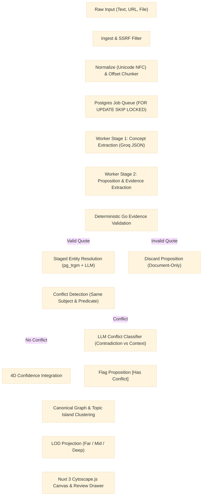

# Gusby — Text-to-Knowledge-Graph Platform

Gusby turns unstructured text, URLs, and documents into connected, structured, trustworthy knowledge.

**Core Principle: Precision over recall.** A small, trustworthy graph beats a large one with erroneous edges. Every relationship is grounded in exact, deterministic verbatim evidence from the original source text with byte and character offsets.

---

## Architecture Overview



---

## Technology Stack

- **Backend**: Go 1.23 (`chi` router, `pgx/v5` connection pool, Argon2id auth, `pdfcpu`, XML DOCX extractor).
- **Frontend**: Nuxt 3 (Vue 3, TypeScript, Tailwind CSS, Cytoscape.js for interactive canvas).
- **Database**: PostgreSQL 16 (Dedicated `gusby` schema, `pg_trgm` extension for trigram similarity).
- **LLM Engine**: Groq API (`openai/gpt-oss-120b`) with JSON mode, bounded repair retries, rate limiting, and token budgeting.

---

## Quickstart Guide

### 1. Prerequisites
- **Docker Compose** (for PostgreSQL 16)
- **Go 1.23+**
- **Node.js 18+** & **npm**
- **Groq API Key**

### 2. Environment Setup
```bash
# Start local PostgreSQL 16
docker compose up -d postgres

# Configure environment variables
cp .env.example .env
# Edit .env and supply your GROQ_API_KEY
```

### 3. Run Backend Server & Worker
```bash
# Starts API server and queue worker on http://127.0.0.1:8080
go run ./cmd/gusby
```

### 4. Run Nuxt 3 Desktop Frontend
```bash
cd frontend
npm install
npm run dev
# Open http://localhost:3000 in your browser
```

Or for production build:
```bash
cd frontend
npm run build
node .output/server/index.mjs
```

---

## Running Test & Benchmark Suites

### 1. Run Unit & Integration Tests
```bash
go test -p 1 ./internal/...
```

### 2. Run the 15-Document Gold Evaluation Benchmark
Audits extraction precision, 100% evidence validity rate, prompt injection defense, and contradiction classification accuracy across 15 curated benchmark documents:
```bash
go test -v ./eval/gusby/...
```

### 3. Run Live End-to-End Real-Groq Audit
Performs a live roundtrip against Groq LLM (`openai/gpt-oss-120b`) ingesting contradictory assertions, verifying exact byte/char offsets and topic clustering:
```bash
go test -v -timeout 120s ./tests/gusby/...
```

---

## Project Specifications & Documentation

Complete architecture specifications reside in `docs/gusby/`:
- `00_PRODUCT_BRIEF.md`: Canonical Product Brief (Vietnamese).
- `01_PRD.md`: Vision, scope boundaries, and explicit out-of-scope list.
- `02_TRD.md`: Stack justification, system architecture, security, and job queue.
- `03_APP_FLOW.md`: Screen routes, review-as-state interaction, and evidence viewing workflow.
- `04_DESIGN_SYSTEM.md`: Pure white canvas, earthy preset palettes, and semantic zoom.
- `05_SCHEMA_AND_API.md`: PostgreSQL schema DDL and REST API specifications.
- `06_IMPLEMENTATION_PLAN.md`: Milestones, dependencies, and evaluation framework.
- `ECHO_REMOVAL_INVENTORY.md`: Forensic audit of removed legacy Echo components.
- `DECISIONS.md`: Strategic architecture decisions log.
