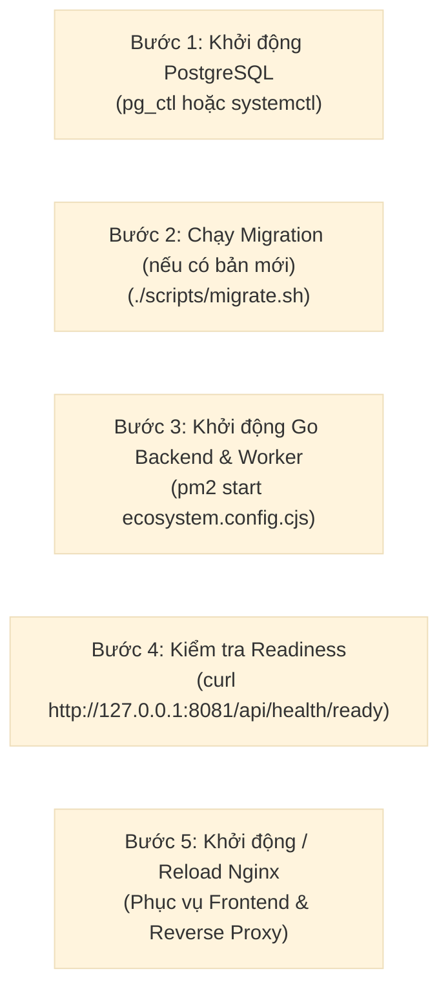

# Sổ Tay Vận Hành Gusby (Operations Guide)

Tài liệu cung cấp hướng dẫn vận hành hàng ngày, giám sát, bảo trì, xử lý sự cố và quy trình khẩn cấp cho hệ thống Gusby Knowledge Graph trên môi trường sản xuất (Linux VPS và Termux Lab).

---

## 1. Bảng Lệnh Vận Hành Nhanh (Cheatsheet)

| Tác Vụ | Lệnh Thực Thi (Linux VPS) | Lệnh Thực Thi (Android Termux) |
|---|---|---|
| **Xem trạng thái app** | `pm2 status` | `pm2 status` |
| **Xem log trực tiếp** | `pm2 logs gusby-backend` | `pm2 logs gusby-backend` |
| **Khởi động app** | `pm2 start ecosystem.config.cjs` | `pm2 start ecosystem.config.cjs` |
| **Khởi động lại app** | `pm2 restart gusby-backend` | `pm2 restart gusby-backend` |
| **Dừng app** | `pm2 stop gusby-backend` | `pm2 stop gusby-backend` |
| **Khởi động Nginx** | `sudo systemctl start nginx` | `nginx` |
| **Reload Nginx** | `sudo systemctl reload nginx` | `nginx -s reload` |
| **Dừng Nginx** | `sudo systemctl stop nginx` | `nginx -s stop` |
| **Khởi động PostgreSQL** | `sudo systemctl start postgresql` | `pg_ctl -D $PREFIX/var/lib/postgresql start` |
| **Dừng PostgreSQL** | `sudo systemctl stop postgresql` | `pg_ctl -D $PREFIX/var/lib/postgresql stop` |
| **Trạng thái PostgreSQL**| `sudo systemctl status postgresql`| `pg_ctl -D $PREFIX/var/lib/postgresql status` |
| **Kiểm tra liveness** | `curl -s http://127.0.0.1:8080/api/health` | `curl -s http://127.0.0.1:8080/api/health` |
| **Kiểm tra readiness**| `curl -s http://127.0.0.1:8080/api/health/ready` | `curl -s http://127.0.0.1:8080/api/health/ready` |

---

## 2. Quy Trình Khởi Động Hệ Thống Theo Thứ Tự Chuẩn

Để tránh lỗi kết nối hoặc gián đoạn dịch vụ, luôn khởi động các thành phần theo thứ tự phụ thuộc:



---

## 3. Quản Trị Người Dùng & Phân Quyền Qua CLI

Gusby tích hợp sẵn bộ lệnh CLI quản trị tài khoản không cần truy cập trực tiếp vào giao diện web:

```bash
# Liệt kê danh sách các tài khoản có quyền Admin
./bin/gusby admin list

# Cấp quyền Admin cho người dùng theo email
./bin/gusby admin grant --email user@example.com

# Thu hồi quyền Admin từ người dùng
./bin/gusby admin revoke --email user@example.com
```

---

## 4. Quản Lý AI Circuit Breaker & Gate

Gusby sở hữu cơ chế bảo vệ AI Circuit Breaker tự động ngắt mạch khi Groq API gặp sự cố liên tiếp (5 lần thất bại liên tiếp).

### 4.1. Kiểm tra trạng thái AI Gate
Truy cập qua API Admin:
```bash
curl -s -b "gusby_session=YOUR_ADMIN_SESSION" http://127.0.0.1:8080/api/admin/ai/gate
```

### 4.2. Khôi phục Circuit Breaker thủ công
Khi Groq API đã ổn định trở lại:
```bash
curl -X POST -b "gusby_session=YOUR_ADMIN_SESSION" http://127.0.0.1:8080/api/admin/ai/gate/reset-breaker
```

### 4.3. Tạm dừng / Tiếp tục xử lý AI
- **Tạm dừng toàn bộ tác vụ gọi LLM**:
  ```bash
  curl -X POST -H "Content-Type: application/json" -d '{"reason": "Bảo trì định kỳ"}' -b "gusby_session=..." http://127.0.0.1:8080/api/admin/ai/gate/pause
  ```
- **Kích hoạt chạy lại**:
  ```bash
  curl -X POST -b "gusby_session=..." http://127.0.0.1:8080/api/admin/ai/gate/resume
  ```

---

## 5. Giám Sát Hàng Đợi Tác Vụ (Job Queue)

Hàng đợi xử lý tài liệu của Gusby chạy trực tiếp trên bảng `gusby.processing_jobs` bằng cơ chế `FOR UPDATE SKIP LOCKED`.

### Kiểm tra các tác vụ đang kẹt hoặc thất bại:
```sql
SELECT id, document_id, stage, attempts, last_error, run_at, locked_at, locked_by
FROM gusby.processing_jobs
WHERE stage IN ('failed', 'waiting_for_ai')
ORDER BY updated_at DESC
LIMIT 10;
```

### Đẩy lại (retry) một tác vụ thất bại qua API:
```bash
curl -X POST -b "gusby_session=YOUR_ADMIN_SESSION" http://127.0.0.1:8080/api/admin/pipeline/jobs/JOB_ID/retry
```

---

## 6. Quy Trình Backup & Restore Định Kỳ

### 6.1. Script Tự Động Sao Lưu Hàng Ngày (Cron Job)

Tạo file `/var/www/gusby/scripts/backup.sh` (hoặc trong thư mục scripts):

```bash
#!/usr/bin/env bash
set -euo pipefail

BACKUP_DIR="${HOME}/backups/gusby"
mkdir -p "$BACKUP_DIR"

TIMESTAMP=$(date +"%Y%m%d_%H%M%S")
BACKUP_PATH="$BACKUP_DIR/gusby_db_${TIMESTAMP}.sql.gz"

pg_dump -h 127.0.0.1 -U gusby_user -d gusby_db | gzip > "$BACKUP_PATH"

# Giữ lại các bản sao lưu trong 14 ngày gần nhất, xóa bản cũ hơn
find "$BACKUP_DIR" -type f -name "gusby_db_*.sql.gz" -mtime +14 -delete

echo "[$(date)] Backup completed: $BACKUP_PATH"
```

---

## 7. Xử Lý Sự Cố Khẩn Cấp (Incident Response)

### Tình huống 1: Go Backend chiếm dụng nhiều RAM trên Android
1. PM2 được cấu hình tự khởi động lại khi đạt ngưỡng 256MB RAM (`max_memory_restart: '256M'`).
2. Nếu cần cưỡng chế dọn dẹp:
   ```bash
   pm2 restart gusby-backend
   ```

### Tình huống 2: Mất kết nối PostgreSQL sau khi reboot
1. Kiểm tra tiến trình PostgreSQL:
   - Linux: `sudo systemctl status postgresql`
   - Termux: `pg_ctl -D $PREFIX/var/lib/postgresql status`
2. Nếu bị khóa lock file do tắt nguồn đột ngột (`postmaster.pid`):
   ```bash
   rm -f $PREFIX/var/lib/postgresql/postmaster.pid
   pg_ctl -D $PREFIX/var/lib/postgresql start
   ```

### Tình huống 3: Quá hạn mức Groq API (Rate Limit / Quota Exceeded)
1. Các job sẽ tự động rơi vào trạng thái `waiting_for_ai` và backoff.
2. Kiểm tra log: `grep "rate_limited" logs/backend-out.log`
3. Job sẽ tự động phục hồi khi cửa sổ giới hạn của Groq được mở lại mà không làm mất dữ liệu.
