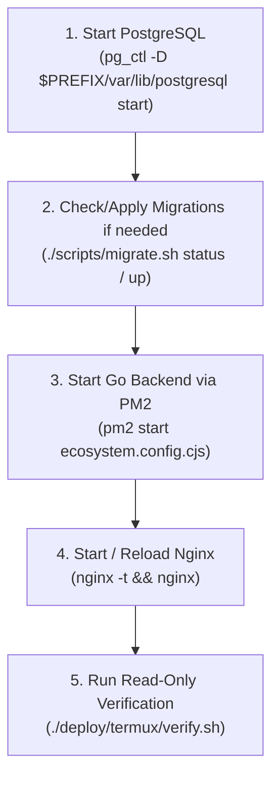

# Gusby Operations Guide (Sony Xperia Termux)

This document provides day-to-day operations, monitoring, maintenance, and emergency response procedures for Gusby on the Sony Xperia 1 (Android Termux) production host.

---

## 1. Quick Operations Cheatsheet

| Task | Command on Android Termux |
|---|---|
| **View App Process Status** | `pm2 status` |
| **Inspect System Health (Read-Only)** | `~/apps/gusby/deploy/termux/verify.sh` |
| **View System Overview** | `~/apps/gusby/deploy/termux/status.sh` |
| **Live Backend Logs** | `pm2 logs gusby-backend` |
| **Persistent Out Log** | `tail -f ~/services/gusby/shared/logs/backend-out.log` |
| **Persistent Error Log** | `tail -f ~/services/gusby/shared/logs/backend-err.log` |
| **Restart Backend Process** | `pm2 restart gusby-backend` |
| **Stop Backend Process** | `pm2 stop gusby-backend` |
| **Start Nginx** | `nginx` |
| **Test Nginx Config** | `nginx -t` |
| **Reload Nginx** | `nginx -s reload` |
| **Stop Nginx** | `nginx -s stop` |
| **Start PostgreSQL** | `pg_ctl -D $PREFIX/var/lib/postgresql start` |
| **PostgreSQL Status** | `pg_ctl -D $PREFIX/var/lib/postgresql status` |
| **Stop PostgreSQL** | `pg_ctl -D $PREFIX/var/lib/postgresql stop` |
| **Check Liveness Probe** | `curl -s http://127.0.0.1:8081/api/health/live` |
| **Check Readiness Probe** | `curl -s http://127.0.0.1:8081/api/health/ready` |

---

## 2. Service Startup Sequence

Because database and reverse proxy lifecycles are decoupled from application releases, always start dependencies in logical order:



---

## 3. User Administration & Permissions via CLI

Gusby includes built-in admin CLI subcommands in the Go binary:

```bash
cd ~/services/gusby/current

# List all admin users
./bin/gusby admin list

# Grant admin privileges to a user
./bin/gusby admin grant --email user@example.com

# Revoke admin privileges from a user
./bin/gusby admin revoke --email user@example.com
```

---

## 4. AI Gate & Circuit Breaker Administration

Gusby protects against Groq API failures with an autonomous circuit breaker.

### 4.1 Check AI Gate Status
```bash
curl -s -b "gusby_session=YOUR_ADMIN_SESSION" http://127.0.0.1:8080/api/admin/ai/gate
```

### 4.2 Reset Circuit Breaker Manually
```bash
curl -X POST -b "gusby_session=YOUR_ADMIN_SESSION" http://127.0.0.1:8080/api/admin/ai/gate/reset-breaker
```

---

## 5. Job Queue Maintenance

Gusby's job queue runs directly on `gusby.processing_jobs` using `FOR UPDATE SKIP LOCKED`.

### Check stuck or failed jobs:
```sql
psql -d gusby_db -c "
SELECT id, document_id, stage, attempts, last_error, run_at, locked_at
FROM gusby.processing_jobs
WHERE stage IN ('failed', 'waiting_for_ai')
ORDER BY updated_at DESC
LIMIT 10;
"
```

---

## 6. Incident Response & Troubleshooting

### Scenario 1: Backend process exceeding mobile memory limit
- PM2 automatically restarts `gusby-backend` if memory exceeds `256M`.
- Manual restart: `pm2 restart gusby-backend`.

### Scenario 2: Stale PostgreSQL lock after abrupt phone shutdown
If the phone lost power, PostgreSQL may report `postmaster.pid` exists:
```bash
pg_ctl -D "$PREFIX/var/lib/postgresql" status
# If process is dead but pid file remains:
rm -f "$PREFIX/var/lib/postgresql/postmaster.pid"
pg_ctl -D "$PREFIX/var/lib/postgresql" -l "$PREFIX/var/log/postgresql.log" start
```

### Scenario 3: Database target verification error
If a script warns about `server_lab`:
- Inspect `~/services/gusby/shared/.env` and verify `GUSBY_DATABASE_URL` targets `gusby_db`.
- Gusby scripts will unconditionally abort before touching `server_lab`.
