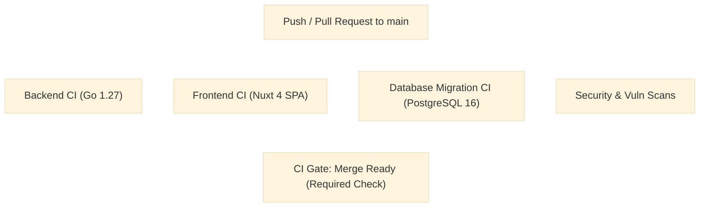

# Gusby Continuous Integration & Delivery (CI/CD)

This document describes the automated pipeline configured in [`.github/workflows/ci.yml`](file:///home/guts/P2/KBA/.github/workflows/ci.yml) and [`.github/workflows/release.yml`](file:///home/guts/P2/KBA/.github/workflows/release.yml).

---

## 1. CI Workflow Structure

The Gusby CI workflow runs on every push and pull request to the `main` branch:

### 1.1 Backend CI Job (`backend-ci`)
- **Go Formatting**: Enforces standard `gofmt -l .`.
- **Go Vet**: Static diagnostics (`go vet ./...`).
- **PostgreSQL Service**: Spins up `postgres:16-alpine` service container.
- **Race Detection & Unit Tests**: Executes `go test -race -v -count=1 ./internal/... ./tests/admin/... ./eval/gusby/...`.
- **Cross-Compilation Verification**: Builds both `gusby-linux-amd64` and `gusby-linux-arm64` with injected build metadata:
  `-ldflags="-s -w -X 'gusby/internal/config.GitCommit=${{ github.sha }}' -X 'gusby/internal/config.BuildTime=...'"`

### 1.2 Frontend CI Job (`frontend-ci`)
- **Strict Lockfile**: `npm ci` using committed `package-lock.json`.
- **TypeScript Typecheck**: Runs `npm run typecheck` (`tsc --noEmit -p .nuxt/tsconfig.json`).
- **Production Static Generation**: Runs `npm run generate` to verify pure static SPA compilation into `.output/public`.
- **Artifact Verification**: Verifies `index.html` and `_nuxt/` asset existence.

### 1.3 Database Migration CI Job (`database-ci`)
- Evaluates [`scripts/migrate.sh`](file:///home/guts/P2/KBA/scripts/migrate.sh) against a fresh PostgreSQL 16 database.
- Verifies `pg_trgm` extension loading and `gusby.schema_migrations` table records.
- Verifies idempotency by executing `migrate.sh` a second time consecutively.

### 1.4 Security & Vulnerability Scans (`security-ci`)
- Runs `govulncheck` on Go dependencies.
- Runs `npm audit --audit-level=high` on frontend dependencies.
- Scans for embedded private keys, tokens, and secrets.

---

## 2. GitHub Branch Protection Setup

To enforce these CI checks before merging:
1. Open GitHub repository `Settings` → `Branches` → `Branch protection rules` for `main`.
2. Enable:
   - **Require a pull request before merging** (1 review required).
   - **Require status checks to pass before merging**:
     - `CI Passed / Merge Ready` (`ci-gate`).
   - **Require branches to be up to date before merging**.
   - **Include administrators**.
