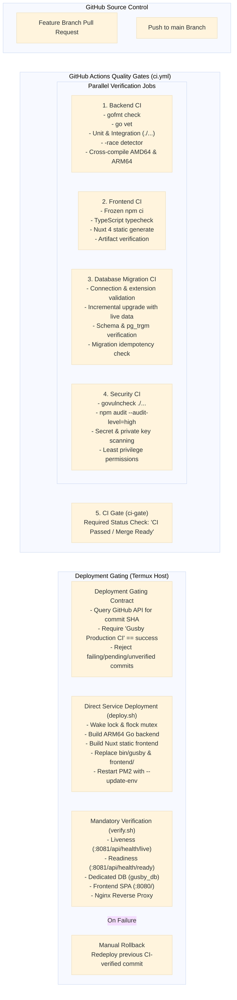

# Gusby Continuous Integration & Delivery (CI/CD)

This document describes the hardened automated pipeline configured in [`.github/workflows/ci.yml`](file:///home/guts/P2/KBA/.github/workflows/ci.yml), [`.github/workflows/release.yml`](file:///home/guts/P2/KBA/.github/workflows/release.yml), and the Termux deployment agent in [`deploy/termux/deploy.sh`](file:///home/guts/P2/KBA/deploy/termux/deploy.sh).

---

## 1. End-to-End Pipeline Architecture

The pipeline enforces strict automated quality gates from pull request through deployment:

---

## 2. CI Quality Gates Detail

### 2.1 Backend CI (`backend-ci`)
- **Go Version**: Go 1.27.3 as declared in [`go.mod`](file:///home/guts/P2/KBA/go.mod).
- **Formatting**: Runs `gofmt -l .` across all Go source files. Fails with non-zero exit code if unformatted files are found.
- **Static Diagnostics**: `go vet ./...` detects suspicious constructs.
- **Service Container**: Dedicated ephemeral `postgres:16-alpine` database (`gusby_test`) on loopback port 5432.
- **Test Discovery & Execution**:
  `go test -race -v -count=1 ./...`
  - Uniformly discovers all packages: `cmd/`, `internal/...`, `tests/admin/...`, `tests/gusby/...`, `eval/gusby/...`.
  - Race condition detection enabled via `-race`.
  - Non-deterministic third-party API dependencies (e.g. Groq) are cleanly decoupled in CI via `SKIP_LIVE_GROQ_TEST=true`.
- **Cross-Compilation**: Verifies static compilation (`CGO_ENABLED=0`) for both `linux/amd64` and `linux/arm64` with version stamping (`GitCommit`, `BuildTime`).

### 2.2 Frontend CI (`frontend-ci`)
- **Node.js**: Node 22 LTS with frozen dependency installation (`npm ci` from `package-lock.json`).
- **Static Type Checking**: `npm run typecheck` (`tsc --noEmit -p .nuxt/tsconfig.json`).
- **Production Static Generation**: `npm run generate` compiles static Single Page Application into `.output/public`.
- **Zero Runtime Memory Architecture**: Served directly as static files by Nginx (`ssr: false`), requiring 0 MB Node.js runtime memory on Android ARM64.
- **Artifact Verification**: Verifies presence of `.output/public/index.html` and `_nuxt/` bundles.

### 2.3 Database CI (`database-ci`)
- **Schema Isolation**: Dedicated PostgreSQL database (`gusby_migration_test`), strictly isolated from production and never touching `server_lab`.
- **Connection & Extension Validation**: Verifies `pg_trgm` extension availability and schema tracker initialization.
- **Incremental Migration Testing**:
  1. Applies initial schema `0001_initial_schema.sql`.
  2. Inserts live representative test data.
  3. Applies pending migrations (`0002_admin_and_ai_observability.sql`) via [`scripts/migrate.sh up`](file:///home/guts/P2/KBA/scripts/migrate.sh).
  4. Asserts that existing data is preserved and new columns are populated with valid defaults.
- **Idempotency**: Executes `scripts/migrate.sh up` a second time consecutively and asserts 0 pending migrations.

### 2.4 Security CI (`security-ci`)
- **Go Vulnerabilities**: `govulncheck ./...` scans for vulnerabilities in Go packages and direct/transitive dependencies.
- **Frontend Vulnerabilities**: `npm audit --audit-level=high` checks npm dependencies.
- **Secret Scanning**: Scans for embedded private keys, tokens, or credentials in tracked files.
- **Least Privilege**: GitHub Actions `permissions: contents: read` restricts token permissions to read-only.

### 2.5 CI Gate (`ci-gate`)
- Required aggregator check `CI Passed / Merge Ready` depending on `[backend-ci, frontend-ci, database-ci, security-ci]`.

---

## 3. Concurrency & Fail-Fast Rules

- **Pull Requests**: Obsolete runs on feature branches are canceled when new commits are pushed (`cancel-in-progress: true`).
- **Main Branch**: Commits pushed to `main` are never canceled (`cancel-in-progress: ${{ github.ref != 'refs/heads/main' }}`), ensuring that every commit on `main` receives an immutable CI verification verdict.

---

## 4. CD Deployment Gating Contract

The Android deployment agent in [`deploy/termux/deploy.sh`](file:///home/guts/P2/KBA/deploy/termux/deploy.sh) strictly enforces the following gating rules before executing:

1. **Immutable Commit Anchoring**: Releases are built strictly from explicit Git commit SHAs, never from moving branch references or uncommitted working trees.
2. **CI Verification Verification**:
   - Queries GitHub Actions API (`https://api.github.com/repos/FatPandaC8/KBA/actions/runs?head_sha=<COMMIT_SHA>`).
   - Checks that `Gusby Production CI` exists and concluded with `status: completed` and `conclusion: success`.
   - Rejects failing (`conclusion: failure`), in-progress, or unverified commits with exit code 1.
3. **Safety Locks & Isolation**:
   - Acquires `flock` on `/tmp/gusby-deploy.lock` to prevent concurrent deployments.
   - Acquires `termux-wake-lock` to prevent Android OS doze throttling.
   - Enforces database URL safety check refusing any connection string pointing to `server_lab`.
4. **Mandatory Verification & Rollback Procedure**:
   - Executes read-only health verification suite (`verify.sh`).
   - If deployment fails or health checks fail, the previous CI-verified commit can be cleanly redeployed (`./deploy/termux/deploy.sh <previous_commit_sha>`).
   - Normal application deployment never executes database migrations, restarts PostgreSQL, or mutates data.

---

## 5. Protected Branch Configuration

Configure GitHub repository settings under `Settings` → `Branches` → `Branch protection rules` for `main`:

- **Require a pull request before merging** (minimum 1 approval).
- **Require status checks to pass before merging**:
  - `CI Passed / Merge Ready` (`ci-gate`).
- **Require branches to be up to date before merging**.
- **Do not allow bypasses** (Include administrators).
- **Require linear history**.
