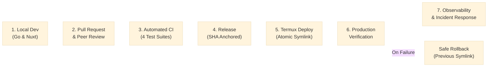

# Gusby Software Development Life Cycle (SDLC)

This document defines the software engineering standards, development lifecycle, and quality gates for the Gusby knowledge graph platform.

---

## 1. Lifecycle Overview

Gusby follows a continuous, verified lifecycle from local development to production on the Sony Xperia 1 (Termux ARM64) host:



---

## 2. Development & Branching Model

- **Trunk-Based Development**: `main` is the primary protected branch.
- **Short-lived Feature Branches**:
  - `feat/<feature-name>`: New application capabilities.
  - `fix/<bug-name>`: Bug fixes and edge-case handling.
  - `infra/<infra-topic>`: CI/CD, deployment scripts, or telemetry.
- **Local Pre-Commit Gates**:
  Every developer must run the local verification suite prior to opening a PR:
  ```bash
  # Go standards & tests
  test -z "$(gofmt -l .)" && go vet ./...
  SKIP_LIVE_GROQ_TEST=true go test -race ./internal/... ./tests/admin/... ./eval/gusby/...
  CGO_ENABLED=0 go build -o bin/gusby ./cmd/gusby

  # Frontend typecheck & bundle
  cd frontend && npm ci && npm run typecheck && npm run generate && cd ..
  ```

---

## 3. Pull Request & Code Review Process

1. **Pull Request Template**:
   All PRs must adhere to [`.github/pull_request_template.md`](file:///home/guts/P2/KBA/.github/pull_request_template.md).
2. **Review Checklist**:
   - Backward-compatible schema migrations (Expand-and-Contract).
   - Zero hardcoded secrets, plain passwords, or unmasked database URLs.
   - Resource-efficient design (memory constraints on Android ARM64).
   - Error handling and bounded retries on external LLM calls.
3. **Mandatory CI Status Checks**:
   The PR cannot be merged until all four CI suites (`Backend CI`, `Frontend CI`, `Database CI`, `Security CI`) pass and signal the `ci-gate` check.

---

## 4. Database Evolution (Expand-and-Contract)

To ensure zero downtime and safe rollbacks on production:

1. **Phase 1 (Expand)**:
   - Add new nullable columns or default values (`ALTER TABLE ... ADD COLUMN ... DEFAULT ...`).
   - Create new tables and indexes.
   - Deploy application version that reads new schema while supporting old structures.
2. **Phase 2 (Migrate)**:
   - Backfill or migrate existing data if needed.
3. **Phase 3 (Contract)**:
   - After the new release is verified and stable, deprecate and drop unused columns in a subsequent release.

**Rules**:
- Never rename or drop active columns in a single step.
- Migrations must be recorded in `gusby.schema_migrations`.
- The target database must never be `server_lab`.
