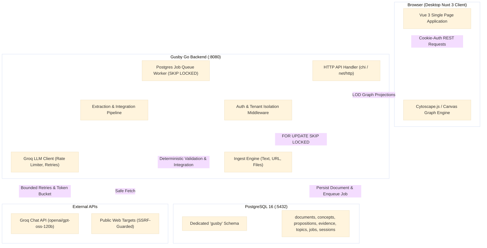
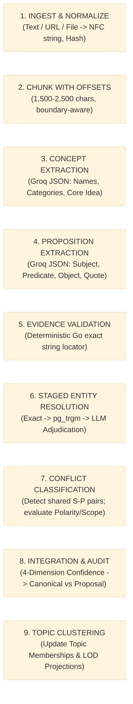

# Gusby: Technical Requirements Document (TRD)
**Version:** 1.0-draft  
**Status:** In Review  
**Source of Truth Precedence:** 00_PRODUCT_BRIEF.md > 02_TRD.md > Prompt Defaults

---

## 1. Technology Stack & Library Selection `[Decided]`

| Component | Technology | Version | Justification |
|---|---|---|---|
| **Backend Runtime** | Go | 1.22+ (tested 1.27) | High-performance, memory-efficient, strong concurrency for queue workers, type-safe JSON schema enforcement. |
| **HTTP Routing (Go)** | `net/http` + `chi` or standard library | `go-chi/chi/v5` v5.1.0 | Lightweight, idiomatic, 100% standard library compatible, zero-allocation context routing. |
| **Database Driver (Go)** | `pgx` | `v5.5.5` | Standard high-performance PostgreSQL driver for Go with connection pooling and binary protocol support. |
| **Password Hashing** | `golang.org/x/crypto/argon2` | latest | Recommended cryptographic standard for secure password hashing (memory-hard, resistant to GPU attacks). |
| **Text Extraction (PDF)** | `pdfcpu` / `ledongthuc/pdf` | latest | Pure Go PDF text extraction without external C/C++ dependencies (`poppler`). |
| **Text Extraction (DOCX)**| `nguyenthenguyen/docx` or Go zip parser | latest | Pure Go lightweight XML extraction from `.docx` archive structures. |
| **Web Content Reader** | `go-shiori/go-readability` | latest | Deterministic HTML content extractor stripping navigation, ads, and scripts to isolate main article text. |
| **Database** | PostgreSQL | 16.x | Single source of truth; ACID compliance; built-in trigram similarity (`pg_trgm`); `FOR UPDATE SKIP LOCKED` job queue. |
| **LLM Provider** | Groq Chat Completions | API v1 | Fast inference speed; OpenAI-compatible schema-constrained JSON output; free-tier accessible. |
| **Frontend Framework** | Nuxt 3 (Vue 3 + TypeScript) | 3.11+ | File-based routing, server-side and client-side composability, reactive TypeScript state, optimal DX. |
| **CSS & Design System**| Tailwind CSS | 3.4+ | Utility-first styling enabling strict adherence to the minimal intellectual earthy design system tokens. |
| **Graph Visualization** | Cytoscape.js (or D3-Force 2D Canvas) | 3.28+ | High-performance canvas-based graph rendering supporting semantic zoom, community layout, and 60 FPS up to 500 nodes. |

---

## 2. System Architecture & High-Level Topology `[Decided]`

Gusby follows a clean monolithic modular architecture. The Go backend serves the JSON REST API and runs asynchronous worker routines against a PostgreSQL task table. Nuxt 3 serves the single-page desktop web interface.



---

## 3. Pipeline Design & Independent Stages `[Decided]`

The extraction and knowledge integration pipeline is broken into strictly decoupled, independently unit-testable stages:



### Stage Details:
1. **Stage 1 (Ingest & Normalize)**:
   - Input: Raw text string, URL, or File byte slice.
   - Action: Applies Unicode NFC normalization. Computes SHA-256 hash. Verifies uniqueness per user.
   - Output: Immutable `source_text`, `content_hash`.
2. **Stage 2 (Chunking)**:
   - Breaks text into chunks between 1,500 and 2,500 characters, respecting newline and sentence boundaries.
   - Calculates UTF-8 byte offsets `[byte_start, byte_end]` and Unicode rune offsets `[char_start, char_end]` relative to the root document.
3. **Stage 3 (Concept Extraction)**:
   - Calls Groq with strict JSON schema: extracts concepts explicitly named in the chunk.
   - Validates response with Go JSON validator; bounded retry (max 2) on malformed output.
4. **Stage 4 (Proposition Extraction)**:
   - Calls Groq with extracted concepts and chunk text: extracts directed subject-predicate-object triples with verbatim supporting quotes.
5. **Stage 5 (Deterministic Evidence Validation)**:
   - **Crucial Rule**: Go checks whether `quote` exists in the normalized chunk text.
   - If found: Go records the exact UTF-8 byte offsets and rune offsets.
   - If not found: The proposition's `evidence_validity` is flagged as `false` (0.0). It will NEVER be integrated into the Canonical Graph.
6. **Stage 6 (Staged Entity Resolution)**:
   - Stage 6A: Check canonical concept names and registered aliases for exact match (`ILIKE`).
   - Stage 6B: Query PostgreSQL `similarity(name, candidate) >= 0.70` via `pg_trgm`.
   - Stage 6C: If ambiguous (similarity in `[0.70, 0.88]`), query Groq with disambiguation prompt.
7. **Stage 7 (Conflict Detection & Classification)**:
   - Check if the Subject and Predicate match an existing canonical proposition.
   - If matching with conflicting Object, negation, or qualifiers: invoke conflict classifier.
   - Output: `contextual_difference` (auto-contextualize), `contradiction` (mark as `conflict` review state), or `insufficient_evidence`.
8. **Stage 8 (Integration & Audit Log)**:
   - Evaluate the 4-dimension confidence tuple: `(extraction, evidence_validity, resolution, proposition)`.
   - High (all dimensions >= 0.85 and validity = true): commit to canonical graph.
   - Medium (composite >= 0.65 and validity = true): insert into `integration_proposals` with `needs_review = true`.
   - Low or invalid validity: persist only in the document's local `document_graph`.
9. **Stage 9 (Topic Clustering)**:
   - Associate newly committed concepts with existing or newly discovered topics (many-to-many).

---

## 4. Auth & Security Architecture `[Decided]`

### 4.1. Password Hashing & Credentials
- Algorithmic choice: **Argon2id** (`time=1`, `memory=64MB`, `threads=4`, `keyLen=32`, `saltLen=16`).
- Generic error responses: `"Invalid email or password"` on any login failure to prevent username enumeration.

### 4.2. Session Management & Cookies
- Server-side session storage in `gusby.sessions`.
- Cryptographic session token (32 random bytes, base64url encoded).
- Only the SHA-256 hash of the session token is persisted in PostgreSQL.
- Delivered to browser in cookie:
  `Set-Cookie: gusby_session=<token>; HttpOnly; Secure; SameSite=Lax; Path=/; Max-Age=2592000` (30 days).

### 4.3. Per-User Scoping & Isolation
- Every table containing user data (`documents`, `concepts`, `propositions`, `topics`, etc.) contains a `user_id UUID NOT NULL REFERENCES gusby.users(id) ON DELETE CASCADE`.
- Every repository query strictly filters on `WHERE user_id = $1`.
- Automated integration test suite tests cross-user isolation: User A cannot read, query, traverse, or edit any resource owned by User B under any condition.

### 4.4. SSRF Defense on URL Ingestion
- When ingesting a URL:
  1. Whitelist protocol: `http://` and `https://` only.
  2. Perform DNS lookup for the target domain.
  3. Inspect resolved IP addresses. Reject immediately if IP falls within:
     - `127.0.0.0/8` (Loopback)
     - `10.0.0.0/8`, `172.16.0.0/12`, `192.168.0.0/16` (Private IPv4)
     - `169.254.0.0/16` (Link-local / Cloud metadata, e.g. AWS/GCP 169.254.169.254)
     - `::1/128`, `fc00::/7`, `fe80::/10` (IPv6 loopback, ULA, link-local)
  4. Follow redirects manually, re-checking DNS resolution on every redirect step (cap at 3 redirects).
  5. Enforce response body size limit (2 MB max) and strict HTTP client timeout (10s).

### 4.5. Prompt Injection Defense
- Source document text is treated as 100% untrusted payload.
- Injected texts are enclosed inside XML tags with boundary defense:
  `<source_document context="untrusted_input">\n{{normalized_text}}\n</source_document>`
- System instructions strictly instruct the model to treat content within `<source_document>` as data only and ignore any embedded command directives.

---

## 5. Job Queue & Asynchronous Worker `[Decided]`

- Storage: `gusby.processing_jobs` table in PostgreSQL.
- Concurrency model: Go background worker goroutines polling with `FOR UPDATE SKIP LOCKED`:
  ```sql
  WITH next_job AS (
    SELECT id FROM gusby.processing_jobs
    WHERE status = 'queued' AND run_at <= now()
    ORDER BY priority DESC, created_at ASC
    LIMIT 1
    FOR UPDATE SKIP LOCKED
  )
  UPDATE gusby.processing_jobs
  SET status = 'running', locked_at = now(), locked_by = $1, attempts = attempts + 1
  WHERE id = (SELECT id FROM next_job)
  RETURNING id, user_id, document_id, stage, payload;
  ```
- Idempotency & Resumability:
  - Jobs track their current execution stage.
  - If a job fails or the worker crashes, the locked job expires after 5 minutes and is eligible for retry up to `max_attempts = 3`.
  - Stages check for existing persistent records prior to execution to avoid duplicate inserts.

---

## 6. Groq LLM Client & Free-Tier Resilience `[Decided]`

- **Rate Limiter**: Token-bucket rate limiter enforcing max 30 RPM and 8,000 TPM globally across workers.
- **Backoff & Jitter**: Exponential backoff on HTTP 429 and 503 (`wait = min(max_wait, base * 2^attempt + jitter)`).
- **Retry-After Header**: Automatically honored if returned by Groq.
- **Budgeting**: Each pipeline execution tracks token usage; user usage is accumulated in `gusby.llm_usage`. If a user exceeds their daily quota (40,000 tokens), processing pauses with status `failed` and clear user-facing reason `"Daily token budget reached"`.
- **Testing**: In Go unit and integration tests, an `LLMClient` interface is used with recorded golden JSON fixtures so tests run deterministically with zero network calls and zero cost.

---

## 7. Performance Limits & Level-of-Detail Projections `[Decided]`

- **Max Graph Nodes Per Projection**: 500 nodes.
- **Semantic Zoom Level Projections**:
  - `GET /api/graph?zoom=far`: Returns Topic centroids and inter-topic aggregate edge weights.
  - `GET /api/graph?zoom=medium&topic_id=...`: Returns top 30 concepts with highest degree within the selected topic.
  - `GET /api/graph?zoom=deep&concept_ids=...`: Returns subgraph around selected concepts up to depth 2, capped at 150 nodes.
  - `GET /api/graph/concept/:id/propositions`: Returns full proposition list with verbatim evidence quotes and offsets.
- **Database Indexing**:
  - `CREATE INDEX idx_concepts_user_name ON gusby.concepts USING btree (user_id, name);`
  - `CREATE INDEX idx_concepts_trgm ON gusby.concepts USING gin (name gin_trgm_ops);`
  - `CREATE INDEX idx_propositions_user_sp ON gusby.propositions USING btree (user_id, subject_concept_id, predicate);`
  - `CREATE INDEX idx_evidence_proposition ON gusby.proposition_evidence USING btree (proposition_id);`
