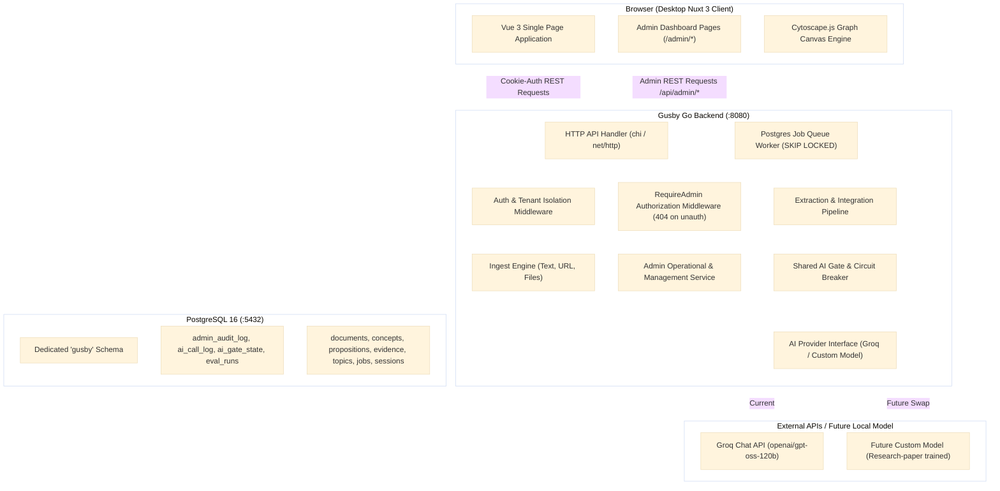
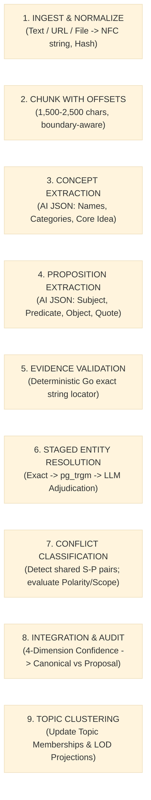

# Gusby: Technical Requirements Document (TRD)
**Version:** 1.1 (Extended via CR-001)  
**Status:** Approved & Binding  
**Source of Truth Precedence:** 00_PRODUCT_BRIEF.md > 02_TRD.md > DECISIONS.md > Prompt Defaults

---

## 1. Technology Stack & Library Selection `[Decided]`

| Component | Technology | Version | Justification |
|---|---|---|---|
| **Backend Runtime** | Go | 1.22+ (tested 1.24/1.27) | High-performance, memory-efficient, strong concurrency for queue workers, type-safe JSON schema enforcement. |
| **HTTP Routing (Go)** | `net/http` + `chi` | `go-chi/chi/v5` v5.1.0 | Lightweight, idiomatic, 100% standard library compatible, zero-allocation context routing. |
| **Database Driver (Go)** | `pgx` | `v5.5.5` | Standard high-performance PostgreSQL driver for Go with connection pooling and binary protocol support. |
| **Password Hashing** | `golang.org/x/crypto/argon2` | latest | Recommended cryptographic standard for secure password hashing (memory-hard, resistant to GPU attacks). |
| **Text Extraction (PDF)** | `pdfcpu` / `ledongthuc/pdf` | latest | Pure Go PDF text extraction without external C/C++ dependencies (`poppler`). |
| **Text Extraction (DOCX)**| `nguyenthenguyen/docx` | latest | Pure Go lightweight XML extraction from `.docx` archive structures. |
| **Web Content Reader** | `go-shiori/go-readability` | latest | Deterministic HTML content extractor stripping navigation, ads, and scripts to isolate main article text. |
| **Database** | PostgreSQL | 16.x | Single source of truth; ACID compliance; built-in trigram similarity (`pg_trgm`); `FOR UPDATE SKIP LOCKED` job queue. |
| **LLM Provider** | Groq Chat API (swap-ready for custom model) | API v1 | Fast inference speed; OpenAI-compatible schema-constrained JSON output; free-tier accessible. |
| **Frontend Framework** | Nuxt 3 (Vue 3 + TypeScript) | 3.11+ / 4.x | File-based routing, reactive TypeScript state, optimal DX. |
| **CSS & Design System**| Tailwind CSS | 3.4+ / 6.x | Utility-first styling enabling strict adherence to the minimal intellectual earthy design system tokens. |
| **Graph Visualization** | Cytoscape.js | 3.28+ | High-performance canvas-based graph rendering supporting semantic zoom, community layout, and 60 FPS up to 500 nodes. |

---

## 2. System Architecture & High-Level Topology `[Decided]`



---

## 3. Pipeline Design & Independent Stages `[Decided]`



### Stage Details:
1. **Stage 1 (Ingest & Normalize)**: Applies Unicode NFC normalization. Computes SHA-256 hash. Verifies uniqueness per user.
2. **Stage 2 (Chunking)**: 1,500 - 2,500 characters, respecting newline/sentence boundaries. Calculates byte offsets and rune offsets.
3. **Stage 3 (Concept Extraction)**: Enforces strict JSON schema via AI Gate. Bounded retry on malformed JSON.
4. **Stage 4 (Proposition Extraction)**: Extracts directed triples with verbatim supporting quotes.
5. **Stage 5 (Deterministic Evidence Validation)**: Go checks whether `quote` exists in the normalized chunk text. If not found, proposition validity is flagged `false` and excluded from Canonical Graph.
6. **Stage 6 (Staged Entity Resolution)**: Exact match → Trigram similarity (`pg_trgm`) → LLM adjudication for ambiguous pairs.
7. **Stage 7 (Conflict Detection & Classification)**: Non-destructive conflict classification (`contextual_difference`, `contradiction`, `insufficient_evidence`).
8. **Stage 8 (Integration & Audit Log)**: Evaluates 4-dimension confidence tuple. High → Canonical; Medium → Integration Proposal with `needs_review = true`.
9. **Stage 9 (Topic Clustering)**: Associative topic islands.

---

## 4. Auth & Security Architecture `[Decided]`

### 4.1. Password Hashing & Credentials
- **Argon2id** (`time=1`, `memory=64MB`, `threads=4`, `keyLen=32`, `saltLen=16`).
- Generic error response: `"Invalid email or password"`.

### 4.2. Session Management & Cookies
- Server-side sessions in `gusby.sessions`, 32-byte crypto tokens (SHA-256 stored).
- Delivered in cookie: `gusby_session=<token>; HttpOnly; Secure (prod); SameSite=Lax; Path=/`.

### 4.3. Per-User Scoping & Isolation
- User-owned tables enforce `user_id UUID NOT NULL REFERENCES gusby.users(id) ON DELETE CASCADE`.
- Repository queries enforce `WHERE user_id = $1`.

---

## 5. Job Queue & Asynchronous Worker `[Decided]`

- Storage: `gusby.processing_jobs` table in PostgreSQL.
- Stages: `queued`, `chunking`, `extracting`, `resolving`, `integrating`, `waiting_for_ai`, `done`, `failed`.
- Concurrency model: Background goroutines polling via `FOR UPDATE SKIP LOCKED`.
- Resumability & Idempotency: Jobs track their current execution stage. Re-running after partial failure resumes from current stage without duplicate entities.

---

## 6. AI Provider Contract & Health Architecture `[Decided - CR-001]`

### 6.1. Provider Contract (Go Interface)
The AI component is abstracted behind a minimal interface designed for both external APIs (Groq today) and future research-paper models (tomorrow):

```go
type AIProvider interface {
    // Identity & non-secret configuration
    Describe() ProviderDescription
    
    // Cheap health probe returning normalized status & generic details map
    Health(ctx context.Context) (ProviderHealth, error)
    
    // Core completions
    Complete(ctx context.Context, system, user string, maxTokens int, temp float64) (string, error)
    CompleteJSON(ctx context.Context, system, user string, maxTokens int, temp float64) (string, CallMetadata, error)
}

type ProviderDescription struct {
    Kind         string   // "groq", "custom", "mock"
    Model        string   // e.g. "openai/gpt-oss-120b"
    Version      string   // Model or checkpoint version
    Capabilities []string // ["json_mode", "streaming", "evidence_adjudication"]
    Config       map[string]any // Non-secret parameters (RPM, TPM, timeout, max_context)
}

type ProviderHealth struct {
    Status    string         // "healthy", "degraded", "down", "paused", "unknown"
    Reason    string         // Explanation of why status was derived
    LatencyMs int64          // Latency of health check in milliseconds
    Details   map[string]any // Generic key-value map (queue depth, VRAM, groq headers, etc.)
}

type CallMetadata struct {
    LatencyMs        int64
    TokensPrompt     int
    TokensCompletion int
    RetryCount       int
    ErrorClass       string // "none", "rate_limited", "timeout", "server_error", "invalid_json", "schema_validation_failed", "budget_exceeded"
    RateLimitState   *RateLimitState
}
```

### 6.2. Per-Call Logging (`gusby.ai_call_log`)
Every AI completion writes one row to `gusby.ai_call_log`:
- Columns: `id`, `timestamp`, `provider`, `model`, `pipeline_stage`, `prompt_version`, `latency_ms`, `status`, `error_class`, `tokens_prompt`, `tokens_completion`, `retry_count`, `run_id`, `user_id`.
- **Strict Privacy Rule**: **NEVER** store prompts, raw model responses, or source document text in this table.
- Retention: Configurable (default 30 days) with automated cleanup.

### 6.3. AI Gate & Circuit Breaker
Shared gateway wrapping all pipeline LLM calls:
- States:
  - `enabled`: Normal operation.
  - `paused`: Admin-paused. Queued jobs transition to `waiting_for_ai` instead of failing.
  - `circuit_open`: Automatically tripped after $N$ consecutive failures (default 5) or error rate $\ge 50\%$ over rolling 10 calls.
  - `half_open`: Allows a single canary trial call. If successful, resets to `enabled`; if failed, re-opens circuit.
- State Persistence: Persisted in `gusby.ai_gate_state` table so gate status survives server restarts.
- Admin Controls: Pause, Resume, Reset Circuit Breaker, Run Active Probe.

### 6.4. Active Health Probe
- Admin-triggered manual check. Executes a fixed harmless prompt (`{"ping": "pong"}`) with minimal token cost ($< 50$ tokens).
- Does not contain user data; logged in `ai_call_log` and audited in `admin_audit_log`.
- Background scheduled probes disabled by default to preserve quota.

---

## 7. Admin Authorization & Security Design `[Decided - CR-001]`

### 7.1. Single-Owner Role & Bootstrapping
- `is_admin` boolean column on `gusby.users`.
- Zero public or user APIs can set or mutate `is_admin`.
- Owner Bootstrapping:
  1. CLI command: `gusby admin grant --email <email>`
  2. Automatic sync on boot if `GUSBY_OWNER_EMAIL` or `E2E_ADMIN_EMAIL` matches.

### 7.2. Server-Side Enforcement (`RequireAdmin`)
- Middleware applied to all `/api/admin/*` routes.
- Verifies: Valid session, user exists, `user.status == 'active'`, `user.is_admin == true`.
- If unauthorized: Returns **HTTP 404 Not Found** (prevents route existence enumeration).

### 7.3. Safeguards & Invariants
- Admin cannot suspend or delete their own account.
- Last remaining admin account cannot be demoted or deleted.
- Destructive operations require explicit typed confirmation (`DELETE / CONFIRM`) matching the resource name.
- Strict multi-tenant scoping: All admin queries operating on user data take explicit `user_id` and enforce repository-level tenant scoping.

---

## 8. Admin Audit Logging & Destructive Semantics `[Decided - CR-001]`

### 8.1. Append-Only Audit Log (`gusby.admin_audit_log`)
- Columns: `id`, `admin_id`, `action_type`, `target_type`, `target_id`, `target_user_id`, `reason`, `before_state`, `after_state`, `request_id`, `created_at`.
- Immutable: Zero update or delete statements allowed on this table.
- Written in the **exact same transaction** as the administrative action.

### 8.2. Destructive Semantics: Document Deletion
1. In a single transaction, remove document, document chunks, and raw evidence rows.
2. Inspect canonical propositions supported by this document. Any proposition left with **zero valid supporting evidence** is **soft-retracted** (`is_canonical = false`, `status = 'retracted'`). It is hidden from standard graph views but preserved with retraction event for auditability.
3. Concepts left with no remaining document references are flagged `orphaned = true` for admin review (not hard deleted).
4. Any conflict or review records referencing the document are updated and logged.
5. All side-effects recorded in `gusby.integration_events` and `gusby.admin_audit_log`.

### 8.3. Destructive Semantics: User Deletion
- Hard delete of user and all cascading resources (documents, chunks, extraction runs, concepts, propositions, topics, sessions, AI call logs) in a single transaction.
- Admin audit log retains a minimal tombstone record: target user ID, email at time of deletion, counts of purged items.

---

## 9. Metrics & Observability via PostgreSQL `[Decided - CR-001]`

No external metrics infrastructure (Prometheus, Grafana). All metrics computed via fast, indexed SQL queries:
- **Queue Health**: Counts grouped by stage (`queued`, `running`, `waiting_for_ai`, `done`, `failed`).
- **Processing Duration**: Median and p95 latency computed over rolling 1h, 24h, 7d windows.
- **AI Latency & Error Rate**: Rolling aggregations over `gusby.ai_call_log` grouped by `error_class`.
- **Quality Signals**:
  - Invalid Evidence Rate: Percentage of propositions flagged `is_valid_evidence = false`.
  - Schema Failure Rate: Percentage of AI calls needing repair or failing schema validation.
  - Invalid JSON Rate: Percentage of raw completions failing JSON unmarshaling.
