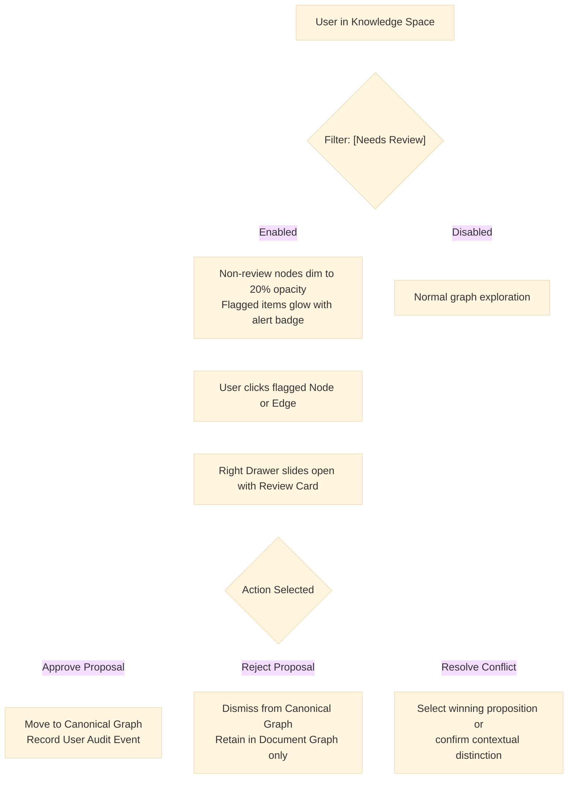

# Gusby: Application Flow & Screen Specification (APP_FLOW.md)
**Version:** 1.0-draft  
**Status:** In Review  
**Source of Truth Precedence:** 00_PRODUCT_BRIEF.md > 03_APP_FLOW.md > Prompt Defaults

---

## 1. Application Routes & Navigation Structure `[Decided]`

Gusby is a desktop-first web application. Its route map is minimal, uncluttered, and intellectual:

```
/ (Root)
 ├── /auth/login         (Sign In screen)
 ├── /auth/signup        (Sign Up screen)
 └── [Authenticated Shell]
      ├── /              (Knowledge Space - central graph canvas)
      ├── /add           (Add Knowledge - ingestion workspace)
      ├── /documents     (Documents - repository list)
      └── /settings      (Settings - minimal preferences)
```

The persistent layout contains a compact icon-only left navigation bar:
- **Logo / Icon**: Gusby circular mark (Home link).
- **Space**: Graph icon (active by default).
- **Add**: Plus icon.
- **Documents**: Folder / Library icon.
- **Settings**: Cog icon (bottom pinned).
- **User Avatar / Sign Out**: Quick indicator.

---

## 2. Screen Specifications & State Transitions `[Decided]`

### Screen 1: Auth (Sign In & Sign Up)
- **Routes**: `/auth/login`, `/auth/signup`
- **Visuals**: Centered minimal form on pure white canvas; typography-driven; no splashy SaaS marketing illustrations; subtle hairline borders.
- **Elements**: Email input, password input, primary submit button ("Sign In" / "Create Account"), toggle link to switch between sign in and sign up.
- **States**:
  - `Default`: Empty input fields.
  - `Submitting`: Button disabled with subtle spinner.
  - `Error`: Inline error message banner (`"Invalid email or password"` or `"Email already registered"`).
- **Acceptance Criteria**:
  1. Valid credentials set the `gusby_session` HttpOnly cookie and redirect immediately to `/`.
  2. Failed login displays a generic error message without enumerating whether the email exists.
  3. Attempting to access protected routes without an active session immediately redirects to `/auth/login`.

---

### Screen 2: Knowledge Space (Central Interactive Canvas)
- **Route**: `/`
- **Visuals**: Fullscreen pure white canvas displaying interactive Topic Islands and Concepts; floating top search bar; floating bottom-right zoom/LOD controls; collapsible right detail drawer.
- **Controls**:
  - **Floating Search Bar**: Top center. Typing queries filters concepts, dims non-matching nodes, and zooms camera to the best match.
  - **Review State Filter**: Pill toggle `[Needs Review]` in the top-right toolbar. When active, resolved nodes are dimmed (opacity 0.2), and nodes/edges carrying pending proposals or conflicts glow with a warm terracotta badge.
  - **Zoom / View Controls**: Bottom-right zoom buttons (`+`, `-`, `Fit View`), with current zoom level indicator (Far / Mid / Deep).
- **States**:
  - `Loading`: Subtle centered pulsing graph skeleton.
  - `Empty`: Clean message: `"Your knowledge space is empty. Add your first document, URL, or note to begin building your graph."` with a primary button to `/add`.
  - `Populated`: 60 FPS interactive canvas with semantic zoom.
- **Semantic Zoom Transitions**:
  - **Level 1 (Far Zoom, 0.2x - 0.5x)**: Shows Topic Islands as soft circular cluster halos with Topic labels. Clicking a Topic zooms the camera smoothly into that island.
  - **Level 2 (Mid Zoom, 0.5x - 1.2x)**: Shows core/main Concepts as clean circular nodes with legible labels.
  - **Level 3 (Deep Zoom, 1.2x - 2.5x)**: Expands full local concept network with directed proposition edges. Hovering an edge shows predicate label.
  - **Level 4 (Detail Selection)**: Clicking any Concept opens a compact popover with core idea and degree count; clicking "View Details" smoothly slides out the Right Detail Panel.
- **Acceptance Criteria**:
  1. Semantic zoom levels smoothly adapt level-of-detail without frame drops.
  2. Canvas renders up to 500 nodes at constant 60 FPS.
  3. Clicking any node updates URL hash or state (`/?concept=<id>`) without reloading.

---

### Screen 3: Add Knowledge (Ingestion Workspace)
- **Route**: `/add`
- **Visuals**: Focused, distraction-free input surface with generous whitespace.
- **Tabs**:
  1. **Paste Text**: Multi-line textarea with live character counter (up to 50,000 chars) and title input.
  2. **URL**: Clean input field for pasting article/documentation URLs.
  3. **Upload File**: Drag-and-drop zone supporting `.txt`, `.pdf`, `.docx` up to 10MB.
- **Submit Action**: Single primary action button `"Process Knowledge"`.
- **States**:
  - `Ready`: Clean inputs.
  - `Submitting`: File upload progress bar.
  - `Queued / Processing`: Shows progress indicator: `"Extracting concepts and evidence..."`.
  - `Success`: Displays extraction summary (e.g. `14 concepts, 22 propositions, 100% evidence verified`) with buttons `"View in Knowledge Space"` and `"Add Another"`.
  - `Error`: Clear error toast explaining failure (e.g. `"Scanned PDFs without digital text layers are not supported"`, `"URL is not accessible or private IP is blocked"`).
- **Acceptance Criteria**:
  1. Duplicate content hash displays notice `"Document already ingested on YYYY-MM-DD"` and navigates to existing document.
  2. Malicious or SSRF target URLs are blocked with immediate rejection message.
  3. Ingested document is immediately enqueued in `gusby.processing_jobs`.

---

### Screen 4: Documents (Source Repository)
- **Route**: `/documents`
- **Visuals**: Clean, high-density minimal tabular view.
- **Columns**: Title/Source, Type (`Text`, `URL`, `PDF`, `DOCX`), Added Date, Concepts Extracted, Status badge (`Completed`, `Processing`, `Failed`).
- **Actions**:
  - Click row: Opens Document Drawer showing source text and extracted Document Graph.
  - Retry button: Available for `Failed` rows.
- **States**:
  - `Empty`: `"No documents ingested yet."`
  - `Populated`: Paginated or virtualized list.
- **Acceptance Criteria**:
  1. Shows real-time status updates as processing jobs complete.
  2. Clicking a document reveals its original source text and the exact propositions derived from it.

---

### Screen 5: Settings
- **Route**: `/settings`
- **Visuals**: Minimal preferences form.
- **Sections**:
  1. **Appearance & Palette**: Earthy palette selector (Classic Slate, Terracotta Stone, Forest Moss, Ochre Sand).
  2. **Account**: Email address display, change password fields (Current Password, New Password, Confirm).
  3. **Session & Security**: Sign out button.
  4. **Data Management**: Account Deletion and Data Export marked as `[Needs research: planned for future release]`.
- **Acceptance Criteria**:
  1. Changing palette immediately updates CSS tokens across the entire application without reload.
  2. Password change requires verifying current password and enforcing strength rules.
  3. Sign out revokes session in Postgres, clears cookie, and redirects to `/auth/login`.

---

## 3. Review-as-State Interaction Workflows `[Decided]`

Because Gusby rejects a standalone Review Queue page, review interactions occur in-place:



### Review Card Actions:
1. **Integration Proposal Card**:
   - Shows proposed Concept or Proposition with 4-dimension confidence breakdown.
   - Highlights supporting quote in source text.
   - Buttons: `[Approve & Integrate]` (commits to canonical graph), `[Keep Local Only]` (dismisses proposal).
2. **Conflict Resolution Card**:
   - Displays Proposition A (Source 1, Date 1, Evidence 1) vs Proposition B (Source 2, Date 2, Evidence 2).
   - Shows AI classification: `Contradiction` or `Contextual Difference`.
   - Actions:
     - `[Keep Both as Contextual Variants]`: Saves context notes.
     - `[Mark Contradiction Accepted]`: Preserves both with verified dispute flag.
     - `[Override Proposition]`: User explicitly declares preference with audit note.

---

## 4. Evidence Viewing Workflow `[Decided]`

When inspecting any Proposition in the Right Drawer:
1. The user clicks `[View Evidence]`.
2. The drawer displays an inline reader containing the source document chunk.
3. The exact character span (`[char_start, char_end]`) is rendered with an exact hairline highlight:
   `<mark class="evidence-highlight bg-amber-100 text-stone-900 border-b-2 border-amber-500">...</mark>`
4. The document name, chunk index, and extraction timestamp are clearly displayed beneath the citation.
