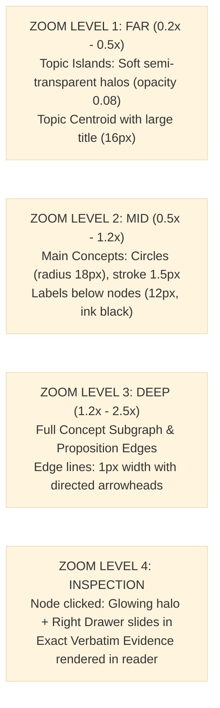

# Gusby: Design System & Visual Specification (DESIGN_SYSTEM.md)
**Version:** 1.0-draft  
**Status:** In Review  
**Source of Truth Precedence:** 00_PRODUCT_BRIEF.md > 04_DESIGN_SYSTEM.md > Prompt Defaults

---

## 1. Aesthetic Vision & Design Philosophy `[Decided]`

Gusby is an **intellectual, editorial, and graph-first** workspace. It rejects the hyper-saturated gradients, cartoonish illustrations, and cluttered widgets of generic SaaS dashboards. 

### Core Aesthetic Axioms:
1. **Pure White Canvas**: Background is strictly pure white (`#FFFFFF`). No muddy gray backgrounds.
2. **Generous Whitespace**: Abundant negative space around elements to foster deep concentration and structural clarity.
3. **Light Mode Only**: No dark mode in MVP. The interface embodies the clarity of crisp white paper and editorial typesetting.
4. **Subtle Hairlines**: Borders are razor-thin (1px) with low-contrast neutral tones (`#E5E7EB` / `#E2E8F0`).
5. **Earthy Preset Palettes**: Accents and node groupings rely on natural, mineral pigments (slate, terracotta, olive moss, ochre sand).
6. **Subtle Motion**: All transitions are understated (150ms–250ms `cubic-bezier(0.16, 1, 0.3, 1)`), zero springy or bouncy cartoon physics.

---

## 2. Color Palette & Design Tokens `[Decided]`

### 2.1. Canvas & Neutral Tokens
```css
:root {
  --canvas-bg: #FFFFFF;
  --surface-raised: #FAFAFA;
  --surface-overlay: #FFFFFF;
  --hairline: #E5E7EB;
  --hairline-focus: #9CA3AF;
  
  --text-primary: #111827;    /* Ink Black */
  --text-secondary: #4B5563;  /* Charcoal */
  --text-muted: #9CA3AF;      /* Muted Slate */
  --text-faint: #D1D5DB;      /* Whispering Silver */
}
```

### 2.2. Earthy Palette Presets (Selectable in Settings)

#### Preset 1: Editorial Slate (Default)
- Primary Accent: `#2C3E50` (Deep Slate)
- Node Fill: `#F1F5F9` (Muted Ice)
- Node Stroke: `#64748B` (Steel Slate)
- Edge Color: `#CBD5E1` (Silver Cord)
- Highlight / Evidence: `#FEF3C7` (Soft Parchment) / Border `#D97706`

#### Preset 2: Terracotta Stone
- Primary Accent: `#9C4221` (Burnt Terracotta)
- Node Fill: `#FDF2E9` (Clay Tint)
- Node Stroke: `#C05621` (Red Clay)
- Edge Color: `#E2D9D2` (Dusty Cord)
- Highlight / Evidence: `#FEE2E2` (Soft Clay Glow) / Border `#B91C1C`

#### Preset 3: Olive Moss
- Primary Accent: `#2D3B2D` (Forest Pine)
- Node Fill: `#F4F7F4` (Sage Mist)
- Node Stroke: `#5A6B5C` (Lichen Green)
- Edge Color: `#D4DDD5` (Earthy Willow)
- Highlight / Evidence: `#FEF9C3` (Sunlit Grass) / Border `#65A30D`

#### Preset 4: Ochre Sand
- Primary Accent: `#6B4F1D` (Raw Umber)
- Node Fill: `#FAF6ED` (Sand Tint)
- Node Stroke: `#9A7B38` (Desert Ochre)
- Edge Color: `#E8E2D5` (Linen Thread)
- Highlight / Evidence: `#FEF3C7` (Amber Wash) / Border `#B45309`

### 2.3. Semantic Status & Review Tokens
- **Needs Review / Flagged**: `#D97706` (Warm Ochre Alert) / Badge `#FEF3C7`
- **Conflict / Contradiction**: `#DC2626` (Muted Crimson) / Background `#FEE2E2`
- **Verified / High Confidence**: `#16A34A` (Forest Green) / Background `#DCFCE7`
- **Processing**: `#3B82F6` (Blueprint Blue) / Background `#EFF6FF`

---

## 3. Typography Hierarchy `[Decided]`

The typography mirrors modern editorial publishing. Clean, legible sans-serif with high contrast and structured rhythm:

- **Font Family**: `Inter, -apple-system, BlinkMacSystemFont, "Segoe UI", Roboto, sans-serif`
- **Code / Evidence Monospace**: `JetBrains Mono, ui-monospace, SFMono-Regular, Menlo, monospace`

| Level | Size | Weight | Line Height | Tracking | Usage |
|---|---|---|---|---|---|
| **Display** | 24px (1.5rem) | 600 Semi-Bold | 1.25 | -0.02em | Space headers, screen titles |
| **Heading 1** | 18px (1.125rem) | 600 Semi-Bold | 1.3 | -0.015em | Panel titles, topic headings |
| **Heading 2** | 14px (0.875rem) | 600 Semi-Bold | 1.4 | -0.01em | Section titles, card headers |
| **Body Primary** | 13px (0.8125rem) | 400 Regular | 1.5 | 0 | Descriptions, propositions, text |
| **Body Semi-Bold**| 13px (0.8125rem) | 500 Medium | 1.5 | 0 | Concept labels, buttons, tabs |
| **Caption / Meta**| 11px (0.6875rem) | 400 Regular | 1.4 | +0.01em | Timestamps, status, offsets |
| **Evidence Span** | 12px (0.75rem) | 400 Regular | 1.6 | 0 | Verbatim cited quotes |

---

## 4. UI Components & Layout Guidelines `[Decided]`

### 4.1. Left Navigation Bar
- Width: Fixed `56px`.
- Background: Pure White (`#FFFFFF`).
- Border: 1px right hairline (`#E5E7EB`).
- Icons: Clean 20px geometric line icons (`lucide-vue-next` or SVG).
- Active State: Clean dark ink icon with subtle 2px left indicator bar.

### 4.2. Knowledge Space Canvas
- Background: `#FFFFFF` with optional faint grid dots (`rgba(0,0,0,0.03)` spaced at 32px).
- Floating Search Bar:
  - Width: `420px`, Height: `40px`.
  - Background: `rgba(255, 255, 255, 0.94)` with `backdrop-filter: blur(8px)`.
  - Border: 1px solid `#E5E7EB`, shadow: `0 4px 16px rgba(0,0,0,0.04)`.
  - Corner radius: `8px`.

### 4.3. Right Detail Drawer (Inspector)
- Width: `420px`.
- Slide-over transition: `transform 220ms ease-out`.
- Header: Entity / Topic title, type badge, confidence pill, close button.
- Body: Scrollable tabbed view (Propositions, Evidence, Provenance, Review Actions).

### 4.4. Buttons & Form Controls
- **Primary Button**: Background `var(--text-primary)`, Text `#FFFFFF`, rounded `6px`, padding `8px 16px`, font-size `13px`, font-weight `500`. Hover: opacity `0.9`.
- **Secondary / Ghost Button**: Background `transparent`, Border 1px solid `#E5E7EB`, Text `var(--text-primary)`, rounded `6px`.
- **Text Inputs**: Border 1px solid `#E5E7EB`, focus ring: `2px solid var(--text-primary)`.

---

## 5. Graph Rendering & Semantic Zoom Visual Rules `[Decided]`



### Node Styling Specifications:
- **Concept Node**:
  - Shape: Perfect circle.
  - Normal State: Radius `14px`, Fill `var(--node-fill)`, Border `1.5px solid var(--node-stroke)`.
  - Hover State: Radius `16px`, Border `2px solid var(--text-primary)`.
  - Selected State: Radius `16px`, Outer ring `4px solid rgba(44, 62, 80, 0.15)`.
  - Flagged for Review: Terracotta badge dot (`6px`) at top-right corner.
- **Edge Styling**:
  - Line: Clean solid line, width `1px`, color `var(--edge-color)`.
  - Arrowhead: Minimal geometric chevron (`size 6px`).
  - Predicate Label: Displayed on hover or deep zoom at midpoint in 10px muted text.
  - Conflicting Edge: Dashed line (`4px dash, 4px gap`), color `#DC2626`.

### Evidence Highlighting:
- Exact character span rendered with:
  ```html
  <span class="px-1 py-0.5 rounded bg-amber-100 text-stone-900 border-b border-amber-500 font-normal">
    "verbatim quote from original document"
  </span>
  ```
