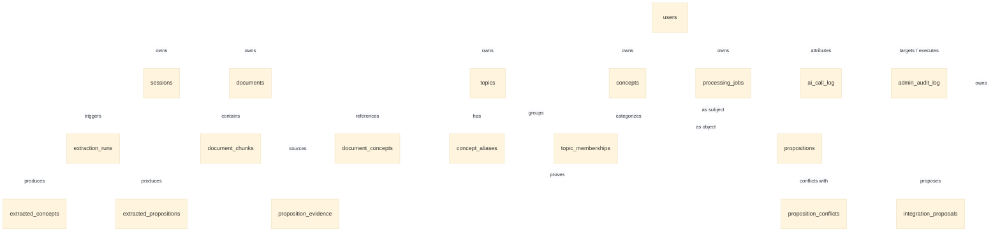

# Gusby: Schema and API Specification (SCHEMA_AND_API.md)
**Version:** 1.1 (Extended via CR-001)  
**Status:** Approved & Binding  
**Source of Truth Precedence:** 00_PRODUCT_BRIEF.md > 05_SCHEMA_AND_API.md > DECISIONS.md > Prompt Defaults

---

## 1. Database Schema Specification (PostgreSQL 16) `[Decided]`

All tables reside strictly within the dedicated schema `gusby`. Every table holding user data carries `user_id UUID NOT NULL REFERENCES gusby.users(id) ON DELETE CASCADE`.



---

### 1.1. Auth & User Tables

```sql
CREATE SCHEMA IF NOT EXISTS gusby;

CREATE TABLE gusby.users (
    id UUID PRIMARY KEY DEFAULT gen_random_uuid(),
    email TEXT NOT NULL,
    email_normalized TEXT NOT NULL,
    password_hash TEXT NOT NULL,
    is_admin BOOLEAN NOT NULL DEFAULT false,
    status TEXT NOT NULL DEFAULT 'active' CHECK (status IN ('active', 'suspended')),
    created_at TIMESTAMPTZ NOT NULL DEFAULT now(),
    updated_at TIMESTAMPTZ NOT NULL DEFAULT now(),
    CONSTRAINT uq_gusby_users_email_normalized UNIQUE (email_normalized)
);

CREATE INDEX idx_gusby_users_status ON gusby.users (status);

CREATE TABLE gusby.sessions (
    id UUID PRIMARY KEY DEFAULT gen_random_uuid(),
    user_id UUID NOT NULL REFERENCES gusby.users(id) ON DELETE CASCADE,
    token_hash TEXT NOT NULL,
    created_at TIMESTAMPTZ NOT NULL DEFAULT now(),
    last_used_at TIMESTAMPTZ NOT NULL DEFAULT now(),
    expires_at TIMESTAMPTZ NOT NULL,
    CONSTRAINT uq_gusby_sessions_token_hash UNIQUE (token_hash)
);

CREATE INDEX idx_gusby_sessions_user_id ON gusby.sessions (user_id);
```

---

### 1.2. Ingestion & Document Tables

```sql
CREATE TABLE gusby.documents (
    id UUID PRIMARY KEY DEFAULT gen_random_uuid(),
    user_id UUID NOT NULL REFERENCES gusby.users(id) ON DELETE CASCADE,
    title TEXT NOT NULL,
    source_type TEXT NOT NULL CHECK (source_type IN ('text', 'url', 'pdf', 'docx')),
    source_url TEXT,
    content_hash TEXT NOT NULL,
    raw_content BYTEA,
    source_text TEXT NOT NULL,
    char_count INTEGER NOT NULL,
    status TEXT NOT NULL CHECK (status IN ('uploading', 'processing', 'completed', 'failed')),
    error_message TEXT,
    created_at TIMESTAMPTZ NOT NULL DEFAULT now(),
    updated_at TIMESTAMPTZ NOT NULL DEFAULT now(),
    CONSTRAINT uq_gusby_documents_user_hash UNIQUE (user_id, content_hash)
);

CREATE TABLE gusby.document_chunks (
    id UUID PRIMARY KEY DEFAULT gen_random_uuid(),
    document_id UUID NOT NULL REFERENCES gusby.documents(id) ON DELETE CASCADE,
    user_id UUID NOT NULL REFERENCES gusby.users(id) ON DELETE CASCADE,
    chunk_index INTEGER NOT NULL,
    chunk_text TEXT NOT NULL,
    byte_start INTEGER NOT NULL,
    byte_end INTEGER NOT NULL,
    char_start INTEGER NOT NULL,
    char_end INTEGER NOT NULL,
    created_at TIMESTAMPTZ NOT NULL DEFAULT now(),
    CONSTRAINT uq_gusby_chunks_doc_index UNIQUE (document_id, chunk_index)
);
```

---

### 1.3. Pipeline & Job Tables

```sql
CREATE TABLE gusby.processing_jobs (
    id UUID PRIMARY KEY DEFAULT gen_random_uuid(),
    user_id UUID NOT NULL REFERENCES gusby.users(id) ON DELETE CASCADE,
    document_id UUID NOT NULL REFERENCES gusby.documents(id) ON DELETE CASCADE,
    stage TEXT NOT NULL CHECK (stage IN ('queued', 'chunking', 'extracting', 'resolving', 'integrating', 'waiting_for_ai', 'done', 'failed')),
    priority INTEGER NOT NULL DEFAULT 0,
    attempts INTEGER NOT NULL DEFAULT 0,
    max_attempts INTEGER NOT NULL DEFAULT 3,
    run_at TIMESTAMPTZ NOT NULL DEFAULT now(),
    locked_at TIMESTAMPTZ,
    locked_by TEXT,
    last_error TEXT,
    failed_stage TEXT,
    started_at TIMESTAMPTZ,
    finished_at TIMESTAMPTZ,
    created_at TIMESTAMPTZ NOT NULL DEFAULT now(),
    updated_at TIMESTAMPTZ NOT NULL DEFAULT now()
);

CREATE INDEX idx_gusby_jobs_poll ON gusby.processing_jobs (run_at, priority DESC)
WHERE stage NOT IN ('done', 'failed');
```

---

### 1.4. Knowledge Graph Tables

```sql
CREATE TABLE gusby.concepts (
    id UUID PRIMARY KEY DEFAULT gen_random_uuid(),
    user_id UUID NOT NULL REFERENCES gusby.users(id) ON DELETE CASCADE,
    name TEXT NOT NULL,
    name_normalized TEXT NOT NULL,
    description TEXT,
    degree INTEGER NOT NULL DEFAULT 0,
    needs_review BOOLEAN NOT NULL DEFAULT false,
    is_orphaned BOOLEAN NOT NULL DEFAULT false,
    is_archived BOOLEAN NOT NULL DEFAULT false,
    created_at TIMESTAMPTZ NOT NULL DEFAULT now(),
    updated_at TIMESTAMPTZ NOT NULL DEFAULT now(),
    CONSTRAINT uq_gusby_concepts_user_name UNIQUE (user_id, name_normalized)
);

CREATE INDEX idx_gusby_concepts_trgm ON gusby.concepts USING gin (name_normalized gin_trgm_ops);

CREATE TABLE gusby.propositions (
    id UUID PRIMARY KEY DEFAULT gen_random_uuid(),
    user_id UUID NOT NULL REFERENCES gusby.users(id) ON DELETE CASCADE,
    subject_concept_id UUID NOT NULL REFERENCES gusby.concepts(id) ON DELETE CASCADE,
    predicate TEXT NOT NULL,
    object_concept_id UUID NOT NULL REFERENCES gusby.concepts(id) ON DELETE CASCADE,
    qualifiers JSONB NOT NULL DEFAULT '{}'::jsonb,
    is_canonical BOOLEAN NOT NULL DEFAULT true,
    has_conflict BOOLEAN NOT NULL DEFAULT false,
    status TEXT NOT NULL DEFAULT 'active' CHECK (status IN ('active', 'retracted')),
    retracted_at TIMESTAMPTZ,
    retracted_reason TEXT,
    confidence_extraction FLOAT NOT NULL,
    confidence_evidence FLOAT NOT NULL,
    confidence_resolution FLOAT NOT NULL,
    confidence_proposition FLOAT NOT NULL,
    created_at TIMESTAMPTZ NOT NULL DEFAULT now(),
    updated_at TIMESTAMPTZ NOT NULL DEFAULT now(),
    CONSTRAINT uq_gusby_propositions_triplet UNIQUE (user_id, subject_concept_id, predicate, object_concept_id)
);

CREATE TABLE gusby.proposition_evidence (
    id UUID PRIMARY KEY DEFAULT gen_random_uuid(),
    proposition_id UUID NOT NULL REFERENCES gusby.propositions(id) ON DELETE CASCADE,
    document_id UUID NOT NULL REFERENCES gusby.documents(id) ON DELETE CASCADE,
    chunk_id UUID REFERENCES gusby.document_chunks(id) ON DELETE SET NULL,
    verbatim_quote TEXT NOT NULL,
    byte_start INTEGER NOT NULL,
    byte_end INTEGER NOT NULL,
    char_start INTEGER NOT NULL,
    char_end INTEGER NOT NULL,
    created_at TIMESTAMPTZ NOT NULL DEFAULT now()
);

CREATE TABLE gusby.topics (
    id UUID PRIMARY KEY DEFAULT gen_random_uuid(),
    user_id UUID NOT NULL REFERENCES gusby.users(id) ON DELETE CASCADE,
    name TEXT NOT NULL,
    description TEXT,
    centroid_x FLOAT NOT NULL DEFAULT 0.0,
    centroid_y FLOAT NOT NULL DEFAULT 0.0,
    is_user_locked BOOLEAN NOT NULL DEFAULT false,
    created_at TIMESTAMPTZ NOT NULL DEFAULT now(),
    updated_at TIMESTAMPTZ NOT NULL DEFAULT now()
);
```

---

### 1.5. Admin & AI Observability Tables `[Decided - CR-001]`

```sql
CREATE TABLE gusby.admin_audit_log (
    id UUID PRIMARY KEY DEFAULT gen_random_uuid(),
    admin_id UUID NOT NULL REFERENCES gusby.users(id),
    action_type TEXT NOT NULL,
    target_type TEXT NOT NULL,
    target_id UUID,
    target_user_id UUID REFERENCES gusby.users(id),
    reason TEXT,
    before_state JSONB,
    after_state JSONB,
    request_id TEXT,
    created_at TIMESTAMPTZ NOT NULL DEFAULT now()
);

CREATE INDEX idx_admin_audit_created ON gusby.admin_audit_log (created_at DESC);
CREATE INDEX idx_admin_audit_action ON gusby.admin_audit_log (action_type);
CREATE INDEX idx_admin_audit_target_user ON gusby.admin_audit_log (target_user_id);

CREATE TABLE gusby.ai_call_log (
    id UUID PRIMARY KEY DEFAULT gen_random_uuid(),
    created_at TIMESTAMPTZ NOT NULL DEFAULT now(),
    provider TEXT NOT NULL,
    model TEXT NOT NULL,
    pipeline_stage TEXT NOT NULL,
    prompt_version TEXT NOT NULL,
    latency_ms INTEGER NOT NULL,
    status TEXT NOT NULL, -- 'success', 'error'
    error_class TEXT NOT NULL, -- 'none', 'rate_limited', 'timeout', 'server_error', 'invalid_json', 'schema_validation_failed', 'auth_error', 'budget_exceeded'
    tokens_prompt INTEGER NOT NULL DEFAULT 0,
    tokens_completion INTEGER NOT NULL DEFAULT 0,
    retry_count INTEGER NOT NULL DEFAULT 0,
    run_id UUID REFERENCES gusby.extraction_runs(id) ON DELETE SET NULL,
    user_id UUID REFERENCES gusby.users(id) ON DELETE CASCADE
);

CREATE INDEX idx_ai_call_log_created ON gusby.ai_call_log (created_at DESC);
CREATE INDEX idx_ai_call_log_provider_model ON gusby.ai_call_log (provider, model);
CREATE INDEX idx_ai_call_log_error_class ON gusby.ai_call_log (error_class) WHERE error_class <> 'none';

CREATE TABLE gusby.ai_gate_state (
    id TEXT PRIMARY KEY DEFAULT 'primary_gate',
    state TEXT NOT NULL CHECK (state IN ('enabled', 'paused', 'circuit_open', 'half_open')),
    reason TEXT NOT NULL,
    consecutive_failures INTEGER NOT NULL DEFAULT 0,
    updated_by TEXT NOT NULL,
    updated_at TIMESTAMPTZ NOT NULL DEFAULT now()
);

CREATE TABLE gusby.eval_runs (
    id UUID PRIMARY KEY DEFAULT gen_random_uuid(),
    dataset_version TEXT NOT NULL,
    model TEXT NOT NULL,
    prompt_version TEXT NOT NULL,
    total_documents INTEGER NOT NULL,
    propositions_audited INTEGER NOT NULL,
    evidence_validity_rate FLOAT NOT NULL,
    injection_defense_rate FLOAT NOT NULL,
    conflict_accuracy FLOAT NOT NULL,
    precision_score FLOAT NOT NULL,
    recall_score FLOAT NOT NULL,
    created_at TIMESTAMPTZ NOT NULL DEFAULT now()
);

CREATE INDEX idx_eval_runs_created ON gusby.eval_runs (created_at DESC);
```

---

## 2. Admin REST API Specification `[Decided - CR-001]`

All endpoints require active session cookie and `is_admin = true`. Unauthorized requests receive **HTTP 404**.

### 2.1. Admin Overview & Pipeline Monitoring

#### `GET /api/admin/overview`
- **Response `200 OK`**:
```json
{
  "ai": {
    "status": "healthy",
    "reason": "0% error rate over last 50 calls",
    "provider": "groq",
    "model": "openai/gpt-oss-120b",
    "is_configured": true
  },
  "pipeline": {
    "queued_jobs": 2,
    "running_jobs": 1,
    "waiting_for_ai_jobs": 0,
    "stuck_jobs": 0,
    "failed_24h": 0
  },
  "users": {
    "total_active": 42,
    "total_suspended": 1,
    "signups_24h": 3
  },
  "graph": {
    "total_concepts": 1420,
    "total_propositions": 2890,
    "active_conflicts": 12
  }
}
```

#### `GET /api/admin/pipeline`
- **Query Params**: `stage`, `limit=50`, `offset=0`
- **Response `200 OK`**:
```json
{
  "stages": {
    "queued": 2,
    "running": 1,
    "waiting_for_ai": 0,
    "done": 120,
    "failed": 3
  },
  "latencies": {
    "chunking_p50_ms": 12,
    "chunking_p95_ms": 45,
    "extracting_p50_ms": 1200,
    "extracting_p95_ms": 2800,
    "resolving_p50_ms": 80,
    "resolving_p95_ms": 210,
    "integrating_p50_ms": 40,
    "integrating_p95_ms": 95
  },
  "stuck_jobs": [],
  "jobs": [
    {
      "id": "uuid",
      "document_id": "uuid",
      "document_title": "String",
      "user_id": "uuid",
      "user_email": "user@example.test",
      "stage": "failed",
      "attempts": 3,
      "last_error": "Connection timeout",
      "created_at": "ISO8601",
      "updated_at": "ISO8601"
    }
  ],
  "total": 126
}
```

#### `POST /api/admin/pipeline/jobs/{id}/retry`
- **Response `200 OK`**:
```json
{
  "job_id": "uuid",
  "status": "queued",
  "message": "Job re-queued for execution"
}
```

---

### 2.2. AI Component Monitoring & Controls

#### `GET /api/admin/ai/health`
- **Response `200 OK`**:
```json
{
  "status": "healthy",
  "reason": "0% error rate over last 50 calls; last probe succeeded in 240ms",
  "latency_ms": 240,
  "provider": {
    "kind": "groq",
    "model": "openai/gpt-oss-120b",
    "version": "1.0",
    "is_configured": true,
    "capabilities": ["json_mode", "streaming"],
    "rpm_limit": 30,
    "tpm_limit": 8000
  },
  "gate": {
    "state": "enabled",
    "reason": "Normal operation",
    "consecutive_failures": 0,
    "updated_at": "ISO8601"
  },
  "details": {
    "groq_reported_rpm_remaining": 29,
    "groq_reported_tpm_remaining": 7820,
    "rate_limit_reset": "2s"
  }
}
```

#### `GET /api/admin/ai/metrics`
- **Query Params**: `window=1h|24h|7d`
- **Response `200 OK`**:
```json
{
  "total_calls": 240,
  "tokens_prompt": 48200,
  "tokens_completion": 14200,
  "latency_p50_ms": 1150,
  "latency_p95_ms": 2400,
  "error_rate": 0.012,
  "errors_by_class": {
    "none": 237,
    "rate_limited": 2,
    "timeout": 1,
    "server_error": 0,
    "invalid_json": 0,
    "schema_validation_failed": 0,
    "budget_exceeded": 0
  },
  "quality_signals": {
    "invalid_evidence_rate": 0.0,
    "schema_failure_rate": 0.008,
    "invalid_json_rate": 0.004
  },
  "last_success_at": "ISO8601",
  "last_failure_at": "ISO8601",
  "last_failure_reason": "429 Too Many Requests"
}
```

#### `POST /api/admin/ai/probe`
- **Response `200 OK`**:
```json
{
  "status": "success",
  "latency_ms": 210,
  "http_status": 200,
  "tokens_consumed": 28,
  "probe_timestamp": "ISO8601"
}
```

#### `POST /api/admin/ai/gate/pause`
- **Request Body**: `{"reason": "Maintenance"}`
- **Response `200 OK`**: `{"gate_state": "paused", "message": "AI gate paused"}`

#### `POST /api/admin/ai/gate/resume`
- **Response `200 OK`**: `{"gate_state": "enabled", "message": "AI gate resumed"}`

#### `POST /api/admin/ai/gate/reset-breaker`
- **Response `200 OK`**: `{"gate_state": "enabled", "message": "Circuit breaker reset to enabled"}`

#### `GET /api/admin/ai/eval-runs`
- **Response `200 OK`**:
```json
{
  "eval_runs": [
    {
      "id": "uuid",
      "dataset_version": "v1.0-gold-benchmark",
      "model": "openai/gpt-oss-120b",
      "prompt_version": "concept-v1.0/prop-v1.0",
      "total_documents": 15,
      "propositions_audited": 23,
      "evidence_validity_rate": 1.0,
      "injection_defense_rate": 1.0,
      "conflict_accuracy": 1.0,
      "created_at": "ISO8601"
    }
  ]
}
```

---

### 2.3. User & Document Management

#### `GET /api/admin/users`
- **Query Params**: `q`, `status=all|active|suspended`, `limit=50`, `offset=0`
- **Response `200 OK`**: `{"users": [...], "total": 42}`

#### `POST /api/admin/users/{id}/suspend`
- **Request Body**: `{"reason": "String"}`
- **Response `200 OK`**: `{"status": "suspended", "sessions_revoked": 2}`

#### `POST /api/admin/users/{id}/unsuspend`
- **Response `200 OK`**: `{"status": "active"}`

#### `POST /api/admin/users/{id}/reset-limits`
- **Response `200 OK`**: `{"message": "Limits reset successfully"}`

#### `DELETE /api/admin/users/{id}`
- **Request Body**: `{"confirmation": "DELETE <email>"}`
- **Response `200 OK`**:
```json
{
  "deleted": true,
  "user_id": "uuid",
  "purged_counts": {
    "documents": 5,
    "concepts": 48,
    "propositions": 72,
    "topics": 3,
    "sessions": 2
  }
}
```

#### `GET /api/admin/documents`
- **Query Params**: `user_id`, `status`, `limit=50`, `offset=0`
- **Response `200 OK`**: `{"documents": [...], "total": 120}`

#### `POST /api/admin/documents/{id}/reprocess`
- **Response `202 Accepted`**: `{"job_id": "uuid", "document_id": "uuid", "status": "queued"}`

#### `DELETE /api/admin/documents/{id}`
- **Request Body**: `{"confirmation": "DELETE <title>"}`
- **Response `200 OK`**:
```json
{
  "deleted": true,
  "document_id": "uuid",
  "propositions_retracted": 4,
  "concepts_orphaned": 2
}
```

---

### 2.4. Graph Data Administration

#### `GET /api/admin/graph/concepts`
- **Query Params**: `user_id` (Required), `q`, `limit=50`, `offset=0`

#### `POST /api/admin/graph/concepts/merge`
- **Request Body**:
```json
{
  "user_id": "uuid",
  "source_concept_id": "uuid",
  "target_concept_id": "uuid",
  "reason": "String"
}
```
- **Response `200 OK`**: `{"merged": true, "updated_propositions_count": 6}`

#### `GET /api/admin/graph/propositions`
- **Query Params**: `user_id` (Required), `status`, `limit=50`, `offset=0`

#### `POST /api/admin/graph/propositions`
- **Request Body**:
```json
{
  "user_id": "uuid",
  "subject_concept_id": "uuid",
  "predicate": "String",
  "object_concept_id": "uuid",
  "document_id": "uuid",
  "verbatim_quote": "Exact substring from document text"
}
```
- **Response `201 Created`**: `{"proposition": {...}}` (Returns `400 Bad Request` if quote does not match document text deterministically).

#### `POST /api/admin/graph/propositions/{id}/retract`
- **Request Body**: `{"user_id": "uuid", "reason": "String"}`
- **Response `200 OK`**: `{"status": "retracted"}`

#### `POST /api/admin/graph/propositions/{id}/restore`
- **Request Body**: `{"user_id": "uuid", "reason": "String"}`
- **Response `200 OK`**: `{"status": "active"}`

#### `POST /api/admin/graph/conflicts/{id}/resolve`
- **Request Body**:
```json
{
  "user_id": "uuid",
  "decision": "contextual_difference|contradiction|dismissed|insufficient_evidence",
  "justification": "String"
}
```

---

### 2.5. Admin Audit Log

#### `GET /api/admin/audit`
- **Query Params**: `action_type`, `target_user_id`, `from`, `to`, `limit=50`, `offset=0`
- **Response `200 OK`**:
```json
{
  "entries": [
    {
      "id": "uuid",
      "admin_id": "uuid",
      "admin_email": "admin@example.test",
      "action_type": "document_delete",
      "target_type": "document",
      "target_id": "uuid",
      "target_user_id": "uuid",
      "reason": "Outdated reference",
      "before_state": {...},
      "after_state": {...},
      "created_at": "ISO8601"
    }
  ],
  "total": 34
}
```
