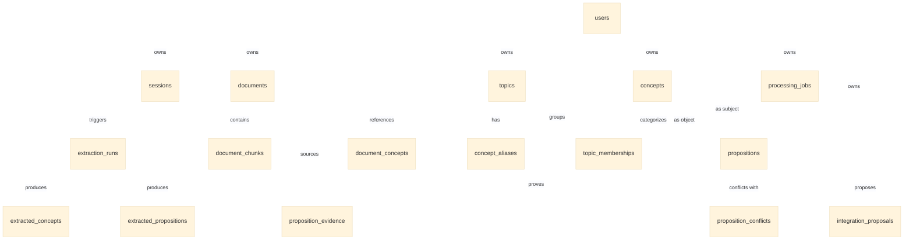

# Gusby: Schema and API Specification (SCHEMA_AND_API.md)
**Version:** 1.0-draft  
**Status:** In Review  
**Source of Truth Precedence:** 00_PRODUCT_BRIEF.md > 05_SCHEMA_AND_API.md > Prompt Defaults

---

## 1. Database Schema Specification (PostgreSQL 16) `[Decided]`

All tables reside strictly within the dedicated schema `gusby`. Every table holding user data carries `user_id UUID NOT NULL REFERENCES gusby.users(id) ON DELETE CASCADE`.



---

### 1.1. Auth & User Tables

```sql
CREATE SCHEMA IF NOT EXISTS gusby;

CREATE TABLE gusby.users (
    id UUID PRIMARY KEY DEFAULT gen_random_uuid(),
    email TEXT NOT NULL,
    email_normalized TEXT NOT NULL,
    password_hash TEXT NOT NULL,
    created_at TIMESTAMPTZ NOT NULL DEFAULT now(),
    updated_at TIMESTAMPTZ NOT NULL DEFAULT now(),
    CONSTRAINT uq_gusby_users_email_normalized UNIQUE (email_normalized)
);

CREATE TABLE gusby.sessions (
    id UUID PRIMARY KEY DEFAULT gen_random_uuid(),
    user_id UUID NOT NULL REFERENCES gusby.users(id) ON DELETE CASCADE,
    token_hash TEXT NOT NULL UNIQUE,
    created_at TIMESTAMPTZ NOT NULL DEFAULT now(),
    last_used_at TIMESTAMPTZ NOT NULL DEFAULT now(),
    expires_at TIMESTAMPTZ NOT NULL
);
CREATE INDEX idx_gusby_sessions_token_hash ON gusby.sessions(token_hash);
CREATE INDEX idx_gusby_sessions_user_id ON gusby.sessions(user_id);
```

---

### 1.2. Source & Ingestion Tables

```sql
CREATE TABLE gusby.documents (
    id UUID PRIMARY KEY DEFAULT gen_random_uuid(),
    user_id UUID NOT NULL REFERENCES gusby.users(id) ON DELETE CASCADE,
    title TEXT NOT NULL,
    source_type TEXT NOT NULL CHECK (source_type IN ('text', 'url', 'pdf', 'docx')),
    source_url TEXT,
    content_hash TEXT NOT NULL,
    raw_content BYTEA,
    source_text TEXT NOT NULL,
    char_count INTEGER NOT NULL,
    status TEXT NOT NULL CHECK (status IN ('uploading', 'processing', 'completed', 'failed')),
    error_message TEXT,
    created_at TIMESTAMPTZ NOT NULL DEFAULT now(),
    updated_at TIMESTAMPTZ NOT NULL DEFAULT now(),
    CONSTRAINT uq_gusby_documents_user_hash UNIQUE (user_id, content_hash)
);
CREATE INDEX idx_gusby_documents_user_status ON gusby.documents(user_id, status);

CREATE TABLE gusby.document_chunks (
    id UUID PRIMARY KEY DEFAULT gen_random_uuid(),
    user_id UUID NOT NULL REFERENCES gusby.users(id) ON DELETE CASCADE,
    document_id UUID NOT NULL REFERENCES gusby.documents(id) ON DELETE CASCADE,
    chunk_index INTEGER NOT NULL,
    chunk_text TEXT NOT NULL,
    byte_start INTEGER NOT NULL,
    byte_end INTEGER NOT NULL,
    char_start INTEGER NOT NULL,
    char_end INTEGER NOT NULL,
    created_at TIMESTAMPTZ NOT NULL DEFAULT now(),
    CONSTRAINT uq_gusby_chunks_doc_index UNIQUE (document_id, chunk_index)
);
CREATE INDEX idx_gusby_chunks_doc ON gusby.document_chunks(document_id);
```

---

### 1.3. Extraction Stage Tables

```sql
CREATE TABLE gusby.extraction_runs (
    id UUID PRIMARY KEY DEFAULT gen_random_uuid(),
    user_id UUID NOT NULL REFERENCES gusby.users(id) ON DELETE CASCADE,
    document_id UUID NOT NULL REFERENCES gusby.documents(id) ON DELETE CASCADE,
    model_name TEXT NOT NULL,
    prompt_version TEXT NOT NULL,
    status TEXT NOT NULL CHECK (status IN ('running', 'completed', 'failed')),
    tokens_prompt INTEGER NOT NULL DEFAULT 0,
    tokens_completion INTEGER NOT NULL DEFAULT 0,
    error_message TEXT,
    started_at TIMESTAMPTZ NOT NULL DEFAULT now(),
    completed_at TIMESTAMPTZ
);

CREATE TABLE gusby.extracted_concepts (
    id UUID PRIMARY KEY DEFAULT gen_random_uuid(),
    user_id UUID NOT NULL REFERENCES gusby.users(id) ON DELETE CASCADE,
    extraction_run_id UUID NOT NULL REFERENCES gusby.extraction_runs(id) ON DELETE CASCADE,
    chunk_id UUID NOT NULL REFERENCES gusby.document_chunks(id) ON DELETE CASCADE,
    name TEXT NOT NULL,
    category TEXT,
    core_idea TEXT,
    confidence_score DOUBLE PRECISION NOT NULL,
    created_at TIMESTAMPTZ NOT NULL DEFAULT now()
);

CREATE TABLE gusby.extracted_propositions (
    id UUID PRIMARY KEY DEFAULT gen_random_uuid(),
    user_id UUID NOT NULL REFERENCES gusby.users(id) ON DELETE CASCADE,
    extraction_run_id UUID NOT NULL REFERENCES gusby.extraction_runs(id) ON DELETE CASCADE,
    chunk_id UUID NOT NULL REFERENCES gusby.document_chunks(id) ON DELETE CASCADE,
    subject_raw TEXT NOT NULL,
    predicate TEXT NOT NULL,
    object_raw TEXT NOT NULL,
    evidence_quote TEXT NOT NULL,
    confidence_score DOUBLE PRECISION NOT NULL,
    is_valid_evidence BOOLEAN NOT NULL DEFAULT FALSE,
    evidence_byte_start INTEGER,
    evidence_byte_end INTEGER,
    evidence_char_start INTEGER,
    evidence_char_end INTEGER,
    created_at TIMESTAMPTZ NOT NULL DEFAULT now()
);
```

---

### 1.4. Canonical Knowledge Graph Tables

```sql
CREATE TABLE gusby.concepts (
    id UUID PRIMARY KEY DEFAULT gen_random_uuid(),
    user_id UUID NOT NULL REFERENCES gusby.users(id) ON DELETE CASCADE,
    name TEXT NOT NULL,
    name_normalized TEXT NOT NULL,
    description TEXT,
    degree INTEGER NOT NULL DEFAULT 0,
    needs_review BOOLEAN NOT NULL DEFAULT FALSE,
    created_at TIMESTAMPTZ NOT NULL DEFAULT now(),
    updated_at TIMESTAMPTZ NOT NULL DEFAULT now(),
    CONSTRAINT uq_gusby_concepts_user_name UNIQUE (user_id, name_normalized)
);
CREATE INDEX idx_gusby_concepts_user_norm ON gusby.concepts(user_id, name_normalized);
CREATE INDEX idx_gusby_concepts_trgm ON gusby.concepts USING gin (name_normalized gin_trgm_ops);

CREATE TABLE gusby.concept_aliases (
    id UUID PRIMARY KEY DEFAULT gen_random_uuid(),
    user_id UUID NOT NULL REFERENCES gusby.users(id) ON DELETE CASCADE,
    concept_id UUID NOT NULL REFERENCES gusby.concepts(id) ON DELETE CASCADE,
    alias TEXT NOT NULL,
    alias_normalized TEXT NOT NULL,
    created_at TIMESTAMPTZ NOT NULL DEFAULT now(),
    CONSTRAINT uq_gusby_aliases_user_alias UNIQUE (user_id, alias_normalized)
);

CREATE TABLE gusby.propositions (
    id UUID PRIMARY KEY DEFAULT gen_random_uuid(),
    user_id UUID NOT NULL REFERENCES gusby.users(id) ON DELETE CASCADE,
    subject_concept_id UUID NOT NULL REFERENCES gusby.concepts(id) ON DELETE CASCADE,
    predicate TEXT NOT NULL,
    object_concept_id UUID NOT NULL REFERENCES gusby.concepts(id) ON DELETE CASCADE,
    qualifiers JSONB NOT NULL DEFAULT '{}'::jsonb,
    is_canonical BOOLEAN NOT NULL DEFAULT TRUE,
    has_conflict BOOLEAN NOT NULL DEFAULT FALSE,
    confidence_extraction DOUBLE PRECISION NOT NULL,
    confidence_evidence DOUBLE PRECISION NOT NULL,
    confidence_resolution DOUBLE PRECISION NOT NULL,
    confidence_proposition DOUBLE PRECISION NOT NULL,
    created_at TIMESTAMPTZ NOT NULL DEFAULT now(),
    updated_at TIMESTAMPTZ NOT NULL DEFAULT now(),
    CONSTRAINT uq_gusby_propositions_triplet UNIQUE (user_id, subject_concept_id, predicate, object_concept_id)
);
CREATE INDEX idx_gusby_prop_user_subj ON gusby.propositions(user_id, subject_concept_id);
CREATE INDEX idx_gusby_prop_user_obj ON gusby.propositions(user_id, object_concept_id);

CREATE TABLE gusby.proposition_evidence (
    id UUID PRIMARY KEY DEFAULT gen_random_uuid(),
    user_id UUID NOT NULL REFERENCES gusby.users(id) ON DELETE CASCADE,
    proposition_id UUID NOT NULL REFERENCES gusby.propositions(id) ON DELETE CASCADE,
    document_id UUID NOT NULL REFERENCES gusby.documents(id) ON DELETE CASCADE,
    chunk_id UUID NOT NULL REFERENCES gusby.document_chunks(id) ON DELETE CASCADE,
    quote TEXT NOT NULL,
    byte_start INTEGER NOT NULL,
    byte_end INTEGER NOT NULL,
    char_start INTEGER NOT NULL,
    char_end INTEGER NOT NULL,
    created_at TIMESTAMPTZ NOT NULL DEFAULT now()
);
CREATE INDEX idx_gusby_evidence_prop ON gusby.proposition_evidence(proposition_id);

CREATE TABLE gusby.document_concepts (
    user_id UUID NOT NULL REFERENCES gusby.users(id) ON DELETE CASCADE,
    document_id UUID NOT NULL REFERENCES gusby.documents(id) ON DELETE CASCADE,
    concept_id UUID NOT NULL REFERENCES gusby.concepts(id) ON DELETE CASCADE,
    created_at TIMESTAMPTZ NOT NULL DEFAULT now(),
    PRIMARY KEY (document_id, concept_id)
);
```

---

### 1.5. Topics & Organizational Layer

```sql
CREATE TABLE gusby.topics (
    id UUID PRIMARY KEY DEFAULT gen_random_uuid(),
    user_id UUID NOT NULL REFERENCES gusby.users(id) ON DELETE CASCADE,
    name TEXT NOT NULL,
    description TEXT,
    color_index INTEGER NOT NULL DEFAULT 0,
    centroid_x DOUBLE PRECISION NOT NULL DEFAULT 0.0,
    centroid_y DOUBLE PRECISION NOT NULL DEFAULT 0.0,
    created_at TIMESTAMPTZ NOT NULL DEFAULT now(),
    updated_at TIMESTAMPTZ NOT NULL DEFAULT now(),
    CONSTRAINT uq_gusby_topics_user_name UNIQUE (user_id, name)
);

CREATE TABLE gusby.topic_memberships (
    user_id UUID NOT NULL REFERENCES gusby.users(id) ON DELETE CASCADE,
    topic_id UUID NOT NULL REFERENCES gusby.topics(id) ON DELETE CASCADE,
    concept_id UUID NOT NULL REFERENCES gusby.concepts(id) ON DELETE CASCADE,
    affinity_score DOUBLE PRECISION NOT NULL DEFAULT 1.0,
    created_at TIMESTAMPTZ NOT NULL DEFAULT now(),
    PRIMARY KEY (topic_id, concept_id)
);
CREATE INDEX idx_gusby_topic_concept ON gusby.topic_memberships(concept_id);
```

---

### 1.6. Audit, Conflict & Review Tables

```sql
CREATE TABLE gusby.integration_proposals (
    id UUID PRIMARY KEY DEFAULT gen_random_uuid(),
    user_id UUID NOT NULL REFERENCES gusby.users(id) ON DELETE CASCADE,
    document_id UUID NOT NULL REFERENCES gusby.documents(id) ON DELETE CASCADE,
    item_type TEXT NOT NULL CHECK (item_type IN ('concept', 'proposition', 'merge')),
    payload JSONB NOT NULL,
    confidence_extraction DOUBLE PRECISION NOT NULL,
    confidence_evidence DOUBLE PRECISION NOT NULL,
    confidence_resolution DOUBLE PRECISION NOT NULL,
    confidence_proposition DOUBLE PRECISION NOT NULL,
    status TEXT NOT NULL DEFAULT 'pending' CHECK (status IN ('pending', 'approved', 'rejected')),
    reviewer_type TEXT CHECK (reviewer_type IN ('user', 'ai')),
    review_notes TEXT,
    created_at TIMESTAMPTZ NOT NULL DEFAULT now(),
    resolved_at TIMESTAMPTZ
);
CREATE INDEX idx_gusby_proposals_user_status ON gusby.integration_proposals(user_id, status);

CREATE TABLE gusby.proposition_conflicts (
    id UUID PRIMARY KEY DEFAULT gen_random_uuid(),
    user_id UUID NOT NULL REFERENCES gusby.users(id) ON DELETE CASCADE,
    canonical_proposition_id UUID NOT NULL REFERENCES gusby.propositions(id) ON DELETE CASCADE,
    conflicting_proposition_id UUID NOT NULL REFERENCES gusby.propositions(id) ON DELETE CASCADE,
    conflict_type TEXT NOT NULL CHECK (conflict_type IN ('contradiction', 'contextual_difference', 'insufficient_evidence')),
    status TEXT NOT NULL DEFAULT 'open' CHECK (status IN ('open', 'resolved', 'acknowledged')),
    detected_by TEXT NOT NULL DEFAULT 'pipeline',
    created_at TIMESTAMPTZ NOT NULL DEFAULT now(),
    resolved_at TIMESTAMPTZ
);

CREATE TABLE gusby.conflict_resolutions (
    id UUID PRIMARY KEY DEFAULT gen_random_uuid(),
    user_id UUID NOT NULL REFERENCES gusby.users(id) ON DELETE CASCADE,
    conflict_id UUID NOT NULL REFERENCES gusby.proposition_conflicts(id) ON DELETE CASCADE,
    decided_by TEXT NOT NULL CHECK (decided_by IN ('user', 'ai')),
    resolution_choice TEXT NOT NULL,
    reason TEXT NOT NULL,
    created_at TIMESTAMPTZ NOT NULL DEFAULT now()
);

CREATE TABLE gusby.integration_events (
    id UUID PRIMARY KEY DEFAULT gen_random_uuid(),
    user_id UUID NOT NULL REFERENCES gusby.users(id) ON DELETE CASCADE,
    entity_type TEXT NOT NULL,
    entity_id UUID NOT NULL,
    action TEXT NOT NULL,
    actor TEXT NOT NULL CHECK (actor IN ('user', 'ai')),
    details JSONB NOT NULL DEFAULT '{}'::jsonb,
    created_at TIMESTAMPTZ NOT NULL DEFAULT now()
);
```

---

### 1.7. Job Queue & Token Accounting

```sql
CREATE TABLE gusby.processing_jobs (
    id UUID PRIMARY KEY DEFAULT gen_random_uuid(),
    user_id UUID NOT NULL REFERENCES gusby.users(id) ON DELETE CASCADE,
    document_id UUID NOT NULL REFERENCES gusby.documents(id) ON DELETE CASCADE,
    stage TEXT NOT NULL CHECK (stage IN ('queued', 'chunking', 'extracting', 'resolving', 'integrating', 'done', 'failed')),
    priority INTEGER NOT NULL DEFAULT 0,
    attempts INTEGER NOT NULL DEFAULT 0,
    max_attempts INTEGER NOT NULL DEFAULT 3,
    run_at TIMESTAMPTZ NOT NULL DEFAULT now(),
    locked_at TIMESTAMPTZ,
    locked_by TEXT,
    last_error TEXT,
    created_at TIMESTAMPTZ NOT NULL DEFAULT now(),
    updated_at TIMESTAMPTZ NOT NULL DEFAULT now()
);
CREATE INDEX idx_gusby_jobs_poll ON gusby.processing_jobs(status, run_at, priority DESC) WHERE stage NOT IN ('done', 'failed');

CREATE TABLE gusby.llm_usage (
    id UUID PRIMARY KEY DEFAULT gen_random_uuid(),
    user_id UUID NOT NULL REFERENCES gusby.users(id) ON DELETE CASCADE,
    usage_date DATE NOT NULL DEFAULT CURRENT_DATE,
    model TEXT NOT NULL,
    tokens_prompt INTEGER NOT NULL DEFAULT 0,
    tokens_completion INTEGER NOT NULL DEFAULT 0,
    call_count INTEGER NOT NULL DEFAULT 0,
    CONSTRAINT uq_gusby_usage_user_date_model UNIQUE (user_id, usage_date, model)
);
```

---

## 2. API Endpoints & Request/Response Contracts `[Decided]`

All API endpoints return JSON with standard error shapes:
```json
{
  "error": {
    "code": "VALIDATION_FAILED",
    "message": "Human readable message",
    "details": {}
  }
}
```

### 2.1. Authentication APIs
- **`POST /api/auth/signup`**
  - Request: `{"email": "user@example.com", "password": "securePassword123"}`
  - Response (201): `{"user": {"id": "uuid", "email": "user@example.com"}}` + `Set-Cookie: gusby_session=...`
- **`POST /api/auth/login`**
  - Request: `{"email": "user@example.com", "password": "securePassword123"}`
  - Response (200): `{"user": {"id": "uuid", "email": "user@example.com"}}` + `Set-Cookie: gusby_session=...`
- **`POST /api/auth/logout`**
  - Request: `{}`
  - Response (200): `{"success": true}` (clears cookie)
- **`GET /api/auth/me`**
  - Response (200): `{"user": {"id": "uuid", "email": "user@example.com"}}`

---

### 2.2. Ingestion APIs
- **`POST /api/documents/text`**
  - Request: `{"title": "Quantum Note", "content": "Full text..."}`
  - Response (202): `{"document_id": "uuid", "status": "processing", "job_id": "uuid"}`
- **`POST /api/documents/url`**
  - Request: `{"url": "https://example.com/article"}`
  - Response (202): `{"document_id": "uuid", "status": "processing", "title": "Article Title", "job_id": "uuid"}`
- **`POST /api/documents/file`** (Multipart Form)
  - Fields: `file` (binary), `title` (optional string)
  - Response (202): `{"document_id": "uuid", "status": "processing", "file_name": "report.pdf", "job_id": "uuid"}`
- **`GET /api/documents`**
  - Query: `?status=completed&limit=50&offset=0`
  - Response (200): `{"documents": [...], "total": 12}`
- **`GET /api/documents/:id`**
  - Response (200): Full document details with status, character count, extracted concepts, and propositions.
- **`GET /api/documents/:id/chunks/:chunk_id`**
  - Response (200): Chunk text with offsets and verified evidence quotes.

---

### 2.3. Knowledge Graph APIs (LOD Projections)
- **`GET /api/graph`**
  - Query: `?zoom=far|medium|deep&topic_id=uuid&concept_ids=uuid,uuid`
  - Response (200):
    ```json
    {
      "zoom": "far",
      "topics": [
        {"id": "uuid", "name": "Physics", "centroid_x": 120.5, "centroid_y": -45.0, "concept_count": 42}
      ],
      "edges": [
        {"source_topic_id": "uuid", "target_topic_id": "uuid", "weight": 5}
      ]
    }
    ```
- **`GET /api/graph/concept/:id`**
  - Response (200): Concept metadata, aliases, topic memberships, and list of direct connected propositions.
- **`GET /api/graph/proposition/:id`**
  - Response (200): Proposition details, confidence breakdown, conflict status, and supporting evidence spans:
    ```json
    {
      "id": "uuid",
      "subject": {"id": "uuid", "name": "Entanglement"},
      "predicate": "Violates",
      "object": {"id": "uuid", "name": "Bell Inequalities"},
      "confidences": {
        "extraction": 0.95,
        "evidence_validity": 1.0,
        "resolution": 0.92,
        "proposition": 0.89
      },
      "has_conflict": false,
      "evidence": [
        {
          "id": "uuid",
          "document_id": "uuid",
          "document_title": "Quantum Mechanics",
          "quote": "Entanglement directly violates Bell inequalities.",
          "char_start": 1420,
          "char_end": 1471
        }
      ]
    }
    ```

---

### 2.4. Review & Conflict APIs
- **`GET /api/review/proposals`**
  - Query: `?status=pending`
  - Response (200): List of integration proposals needing review.
- **`POST /api/review/proposals/:id/resolve`**
  - Request: `{"action": "approve"|"reject", "notes": "Verified by user"}`
  - Response (200): `{"success": true, "proposal_id": "uuid"}`
- **`GET /api/review/conflicts`**
  - Query: `?status=open`
  - Response (200): List of flagged proposition conflicts.
- **`POST /api/review/conflicts/:id/resolve`**
  - Request: `{"resolution_choice": "keep_both"|"override", "reason": "Contextual distinction"}`
  - Response (200): `{"success": true, "conflict_id": "uuid"}`
