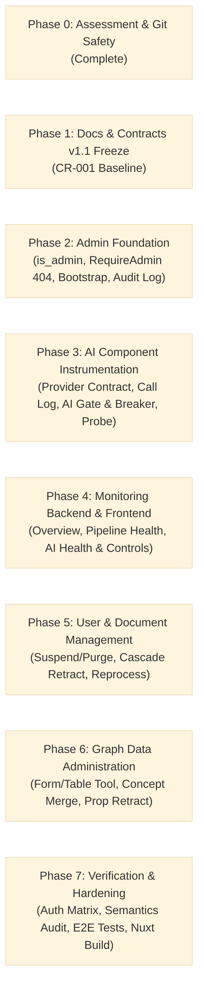

# Gusby: Implementation Plan & Milestone Roadmap (IMPLEMENTATION_PLAN.md)
**Version:** 1.1 (Extended via CR-001)  
**Status:** Approved & Binding  
**Source of Truth Precedence:** 00_PRODUCT_BRIEF.md > 06_IMPLEMENTATION_PLAN.md > DECISIONS.md > Prompt Defaults

---

## 1. Roadmap Milestones & Work Breakdown Structure `[Decided]`

---

## 2. Milestone Deliverables & Task Ownership `[Decided - CR-001]`

### Phase 1: Docs & Contracts v1.1 Freeze
- **Owner**: Docs Writer, Architect, Reviewer
- **Tasks**:
  1. Update six project docs in `docs/gusby/` to v1.1 via CR-001.
  2. Update `contracts/openapi.yaml` with all `/api/admin/*` endpoints and schemas.
  3. Create AI health, probe, and metric contract schemas.
  4. Reviewer verification of docs consistency and zero contradictions.

### Phase 2: Admin Foundation
- **Owner**: Backend Engineer
- **Tasks**:
  1. Database migration: Add `is_admin` and `status` to `gusby.users`; create `gusby.admin_audit_log`.
  2. Store methods in `internal/store/admin.go`: User admin flag, user status mutation, session revocation, audit log insertion & queries.
  3. Bootstrapping: CLI flag / command `cmd/gusby/main.go` and env bootstrap (`GUSBY_OWNER_EMAIL`).
  4. Authorization Middleware: `internal/auth/admin.go`: `RequireAdmin` returning 404 for unauthenticated or non-admin requests.
  5. Safeguards: Self-suspend / self-delete / last-admin removal protection.

### Phase 3: AI Component Instrumentation
- **Owner**: AI Engineer, Backend Engineer
- **Tasks**:
  1. Database migration: Create `gusby.ai_call_log`, `gusby.ai_gate_state`, `gusby.eval_runs`.
  2. Extend `AIProvider` contract in `internal/llm/`: `Describe()`, `Health()`, normalized per-call metadata.
  3. Instrument Groq client with per-call logging to `gusby.ai_call_log` (zero prompt/text storage).
  4. Implement AI Gate & Circuit Breaker in `internal/llm/gate.go` (states: `enabled`, `paused`, `circuit_open`, `half_open`).
  5. Implement Active Health Probe (harmless prompt, small budget, logged and audited).
  6. Persist and expose evaluation benchmark runs in `gusby.eval_runs`.
  7. Unit tests for health derivation, circuit breaker transitions, and paused-gate worker waiting.

### Phase 4: Monitoring Backend & Frontend
- **Owner**: Backend Engineer, Frontend Engineer
- **Tasks**:
  1. Backend API endpoints in `internal/admin/`:
     - `GET /api/admin/overview`
     - `GET /api/admin/pipeline`
     - `POST /api/admin/pipeline/jobs/{id}/retry`
     - `GET /api/admin/ai/health`
     - `GET /api/admin/ai/metrics`
     - `GET /api/admin/ai/eval-runs`
     - `POST /api/admin/ai/probe`
     - `POST /api/admin/ai/gate/pause`, `/resume`, `/reset-breaker`
  2. Frontend Nuxt layout & routing:
     - Sidebar Admin shield icon (only if `user.is_admin === true`).
     - Route middleware guard redirecting non-admins.
     - Admin navigation shell.
  3. Frontend Monitoring screens:
     - Overview page (`/admin`)
     - Pipeline page (`/admin/pipeline`) with stage breakdown and retry actions
     - AI Component page (`/admin/ai`) with status badge & reason, inline SVG sparklines, quality signals, gate controls, and probe modal.

### Phase 5: User & Document Management
- **Owner**: Backend Engineer, Frontend Engineer
- **Tasks**:
  1. Backend API endpoints in `internal/admin/`:
     - Users: List, search, suspend (revoking sessions), unsuspend, hard delete in single transaction with typed confirmation, limit reset.
     - Documents: List with filters, detail drawer, reprocess (new run, idempotent), delete document (with soft retraction of orphaned propositions).
  2. Frontend Management screens:
     - Users page (`/admin/users`) with suspend modal and typed delete modal (`DELETE <email>`).
     - Documents page (`/admin/documents`) with run inspector drawer and typed delete modal (`DELETE <title>`).

### Phase 6: Graph Data Administration
- **Owner**: Backend Engineer, Frontend Engineer
- **Tasks**:
  1. Backend API endpoints in `internal/admin/`:
     - Scoped graph admin taking mandatory `user_id`.
     - Concepts: List, edit, merge with audit event, archive.
     - Propositions: List, edit qualifier/modality, soft-retract, restore, manual addition strictly validated by deterministic evidence validator.
     - Topics: List, edit, set `is_user_locked = true`.
     - Conflicts: List, resolve with recorded decision preserving both propositions.
  2. Frontend Graph Data screen:
     - `/admin/graph` form and table interface with top User Selector dropdown.

### Phase 7: Verification & Hardening
- **Owner**: QA Engineer, Reviewer, Orchestrator
- **Tasks**:
  1. Full Go unit and integration test suite including Authorization Matrix test.
  2. Test destructive semantics: document deletion cascade retraction, concept merge auditability, deterministic evidence enforcement on manual additions.
  3. Test AI failure simulations: circuit breaker trip on consecutive 5xx/429, half-open probe recovery, paused gate job waiting.
  4. Future-model readiness checklist verification.
  5. Nuxt type-check and production build (`npm run build`).
  6. Final session log in Vault.
