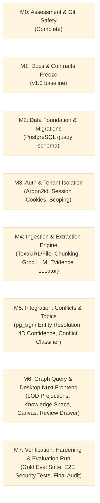

# Gusby: Implementation Plan & Milestone Roadmap (IMPLEMENTATION_PLAN.md)
**Version:** 1.0-draft  
**Status:** In Review  
**Source of Truth Precedence:** 00_PRODUCT_BRIEF.md > 06_IMPLEMENTATION_PLAN.md > Prompt Defaults

---

## 1. Roadmap Milestones & Work Breakdown Structure `[Decided]`

---

## 2. Milestone Deliverables & Task Ownership `[Decided]`

### Milestone 1: Docs & Contracts Freeze (Phase 1)
- **Owner**: Docs Writer, Architect, Reviewer
- **Tasks**:
  1. Complete six binding project docs in `docs/gusby/`.
  2. Architect generates machine-readable contracts in `contracts/`:
     - `contracts/openapi.yaml` (full REST API specification)
     - `contracts/llm/concept_extraction_schema.json`
     - `contracts/llm/proposition_extraction_schema.json`
     - `contracts/llm/entity_adjudication_schema.json`
     - `contracts/llm/conflict_classification_schema.json`
     - `contracts/config/config_schema.json`
  3. Reviewer conducts strict conformance check against `00_PRODUCT_BRIEF.md`.
  4. Freeze docs at v1.0.

### Milestone 2: Data Foundation (Phase 2)
- **Owner**: Backend Engineer
- **Tasks**:
  1. Create Go module in repo root or `cmd/gusby` with clean package architecture.
  2. Implement database migrations for PostgreSQL `gusby` schema.
  3. Create domain entities, repository interfaces, and `pgx` store implementations in `internal/store`.
  4. Unit test database connection, migrations, constraints, and trigram search.

### Milestone 3: Authentication & Multi-Tenant Isolation (Phase 3)
- **Owner**: Backend Engineer, QA Engineer
- **Tasks**:
  1. Implement user registration and login with Argon2id password hashing in `internal/auth`.
  2. Implement cryptographically secure session generation, SHA-256 storage, and `HttpOnly` cookie handling.
  3. Implement auth middleware enforcing strict tenant isolation.
  4. QA: Automated cross-tenant tests proving User A cannot read or modify User B's resources.

### Milestone 4: Ingestion & Extraction Engine (Phase 4)
- **Owner**: AI Engineer, Backend Engineer
- **Tasks**:
  1. Ingestion adapters in `internal/ingest`: raw text, file parser (TXT, PDF, DOCX), SSRF-protected URL reader.
  2. Normalization (Unicode NFC) and boundary-aware chunker with preserved byte and rune offsets.
  3. Groq LLM client in `internal/llm`: token bucket rate limiter, exponential backoff, retry-after header parsing, schema enforcement.
  4. Concept and Proposition extraction stages in `internal/pipeline`.
  5. Deterministic Go evidence validator verifying exact verbatim quotes in source text.
  6. Postgres-backed job queue worker in `internal/queue` using `FOR UPDATE SKIP LOCKED`.

### Milestone 5: Integration, Conflicts & Topics (Phase 5)
- **Owner**: AI Engineer, Backend Engineer
- **Tasks**:
  1. Staged entity resolution: exact match → `pg_trgm` similarity → LLM adjudication.
  2. 4-dimension confidence integration policy: High (canonical), Medium (proposal), Low (document-only), Invalid (rejected).
  3. Conflict detector & classifier: compare Subject-Predicate pairs; classify into Contextual Difference vs Contradiction.
  4. Topic clustering: assign concepts to topics; compute centroid positions.

### Milestone 6: Graph Query & Desktop Nuxt Frontend (Phase 6)
- **Owner**: Frontend Engineer, Backend Engineer
- **Tasks**:
  1. Implement Level-of-Detail (LOD) graph query endpoints in `internal/graph` with node limits.
  2. Scaffold Nuxt 3 application with Tailwind CSS and the earthy design system in `frontend/`.
  3. Build Knowledge Space canvas with Cytoscape.js or 2D Canvas: Topic Islands, semantic zoom (Far, Mid, Deep).
  4. Build Add Knowledge, Documents list, Settings, and Auth screens.
  5. Implement in-place review drawer and verbatim evidence reader with exact character span highlights.

### Milestone 7: Verification, Hardening & Evaluation Run (Phase 7)
- **Owner**: QA Engineer, Reviewer, Orchestrator
- **Tasks**:
  1. Build gold evaluation dataset (10-20 short documents in English & Vietnamese) with ground-truth concepts, propositions, and evidence spans.
  2. Run evaluation CLI tool measuring precision, recall, and evidence validity rate.
  3. Security & edge-case test suite: prompt injection, SSRF attempts, Unicode offsets, rate limits, session expiry.
  4. Reviewer conformance audit and final sign-off.

---

## 3. Evaluation Plan (Gold Evaluation Benchmark) `[Decided]`

The gold evaluation benchmark validates that Gusby honors its fundamental philosophy: **Precision over recall.**

### Benchmark Dataset Composition:
- 15 curated documents:
  - 5 English technical/scientific articles.
  - 5 Vietnamese articles with complex composite diacritics and cultural terms.
  - 3 Contradictory document pairs (conflicting facts from different dates).
  - 2 Adversarial documents (prompt injection attempts, irrelevant noise).
- Manually labeled ground truth:
  - `ground_truth_concepts`: Canonical concept names and acceptable aliases.
  - `ground_truth_propositions`: Valid directed relationships with exact verbatim evidence quotes.
  - `ground_truth_conflicts`: Expected conflict classification.

### Quantitative Metrics:
- **Evidence Validity Rate** = `(Valid Verbatim Spans / Total Extracted Spans) * 100%` (Target: **100%**).
- **Precision** = `(True Positive Propositions / Total Proposed Propositions) * 100%` (Target: **≥ 90%**).
- **Conflict Accuracy** = `(Correctly Classified Conflicts / Total Conflict Pairs) * 100%` (Target: **≥ 85%**).
- **Token Efficiency** = Average Groq tokens consumed per 1,000 document characters.
